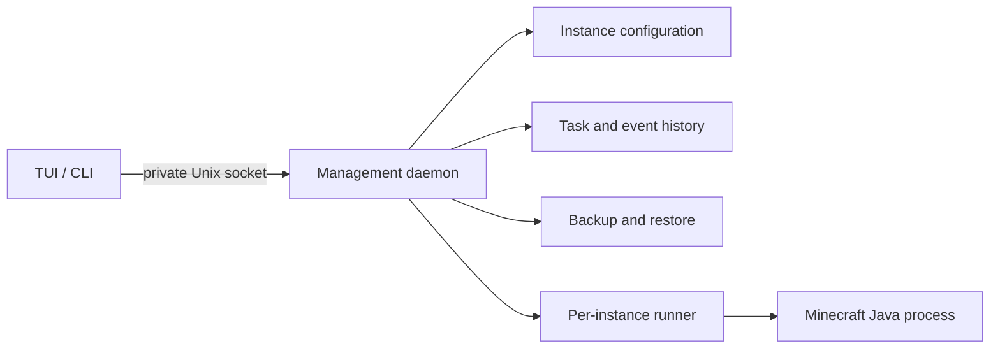

<div align="center">


# mc-server-tui

**Good worlds. Keep them running.**

Paper and Fabric server management for macOS and Linux, from your terminal.

[Website](https://juanwang-buaa.github.io/mc-server-tui/) · [User guide](https://juanwang-buaa.github.io/mc-server-tui/docs/) · [简体中文](README.zh-CN.md) · [v0.2.2](https://github.com/JUANWANG-BUAA/mc-server-tui/releases/tag/v0.2.2)


</div>

Actual v0.2.1 TUI capture with deterministic demonstration data; this session layout is retained in v0.2.2.

## Install and make your first server

Requires macOS 13+ on Apple Silicon or GNU Linux x86_64/arm64, an 80×24 terminal,
and Java compatible with your Minecraft version. The app recommends Java 21 for
1.21.x and Java 25+ for 26.x. The Paper wizard discovers installed Java.

```sh
TAG=v0.2.2
curl -fsSL "https://github.com/JUANWANG-BUAA/mc-server-tui/releases/download/$TAG/install.sh" | sh
mc setup
mc
```

Then type `/create` or click Paper on the welcome screen. Choose an exact game
version, review Java, memory and port, and explicitly accept the Minecraft EULA.
After `/tasks` reports completion:

```text
/instances
/use <number-or-name>
/start
/connect
```

Wait for Minecraft readiness before connecting a matching Java client. See the
[complete tutorial](docs/USER_GUIDE.md) for expected results and recovery steps.
If `mc` is not in PATH, run `export PATH="$HOME/.local/bin:$PATH"`.
For Fabric, review the EULA before using
`/fabric MyFabricServer 1.21.11 --accept-eula`. Clicking the Fabric entry prepares
an editable draft and never submits it automatically.

**v0.2.2 is an unsigned alpha pre-release.** The installer checks SHA-256 and file
size, with no code signature or macOS notarization. Keep independent backups of
important worlds. The alpha does not promise production stability or recovery.

## What you can do

| Workflow | Current behavior |
| --- | --- |
| Create | Guided Paper creation; explicit Fabric command; exact game version and EULA acceptance |
| Operate | Start, graceful stop, controlled restart, console, incremental logs, CPU/RSS, player actions |
| Stay oriented | Selected-instance header, bound console drafts, workspaces, seven themes, command palette |
| Understand failures | Actual reason, recovery advice, expandable evidence, scrollable modal; draft preserved |
| Back up | Stopped-world snapshots, SHA-256 manifests, verification, restore preview and explicit confirmation |
| Configure | Four common properties, diff review, conflict detection and atomic saves |
| Extend | Compatible Paper/Fabric add-ons; ZIP/MRPACK inspection and stopped-instance import |
| Install | Current-user launcher, configuration, launchd/systemd user-service definitions, versioned artifacts |

Each instance has a resident runner. Closing the TUI or restarting the management
daemon leaves its Java process running. **Task history persists; unfinished tasks
do not automatically resume after a daemon restart.** They become `interrupted`.
Download-file resumption is a separate capability.

## Learn one workflow at a time

| Goal | Start here |
| --- | --- |
| Install, create and join | [English tutorial](docs/USER_GUIDE.md#3-install) / [中文快速开始](docs/QUICK_START.md) |
| Protect and restore a world | [Backup lesson](docs/USER_GUIDE.md#8-backups-and-restore) |
| Investigate a failure | [Troubleshooting](docs/USER_GUIDE.md#13-troubleshooting) / [中文速查](docs/TROUBLESHOOTING_CHEATSHEET.md) |
| Check support and evidence | [Acceptance](docs/acceptance/0.2.2.md) / [Current gaps](docs/IMPLEMENTATION_GAPS.md) |
| Contribute or package | [Documentation index](docs/README.md) / [Release process](docs/RELEASING.md) |

Vanilla, existing-directory takeover, online/scheduled backups, Forge/NeoForge,
signed releases and a signed automatic updater remain future work. The Linux
binaries are built in CI; a real Linux user-service drill and client verification
of a restored world remain open. `/connect` does not verify internet reachability.

## Build and verify

The repository pins Rust 1.89.0. The site uses Python’s standard library and
plain HTML/CSS/JavaScript; no frontend package installation is needed.

```sh
cargo build --workspace --locked
./target/debug/mc setup
./target/debug/mc
```

For a foreground daemon, use `mc setup --no-service`, then `mc daemon run` and
`mc tui` in separate terminals. CLI lifecycle commands require instance UUIDs:
`mc cli instance list`, then `mc cli instance start <UUID>`.

```sh
cargo fmt --all --check
cargo clippy --workspace --all-targets --all-features --locked -- -D warnings
cargo test --workspace --all-targets --locked
cargo test --workspace --doc --locked
python3 scripts/build_landing_site.py
python3 scripts/build_docs_site.py
python3 scripts/check_docs.py
python3 scripts/check_protocol_window.py
python3 scripts/test_first_time_experience.py
```

The local macOS baseline is 258 tests, including 104 TUI tests, and five PTY
flows. See the dated [acceptance record](docs/acceptance/0.2.2.md), which separates
fake-daemon UI checks from historical real Paper evidence and remote CI.

## How it works



Instance config/lock files and the SQLite index live in application state.
`mc doctor --json` prints the actual paths. The runner owns process identity,
console and logs; the daemon coordinates bounded operations and durable records.
See [supervision](docs/SUPERVISION.md), [instance schema](docs/INSTANCE_SCHEMA.md)
and [backup design](docs/BACKUP_RESTORE_DESIGN.md) for the runtime contracts.

## Contributing and license

Read [CONTRIBUTING](CONTRIBUTING.md), [SECURITY](SECURITY.md), and the
[code of conduct](CODE_OF_CONDUCT.md). Licensed under [MIT](LICENSE-MIT) OR
[Apache-2.0](LICENSE-APACHE).

Independent project, not affiliated with Mojang, Microsoft, PaperMC, Modrinth,
Fabric or Forge. Minecraft is a trademark of Mojang Synergies AB. You are
responsible for the EULA, third-party licenses, hosting access and world backups.
