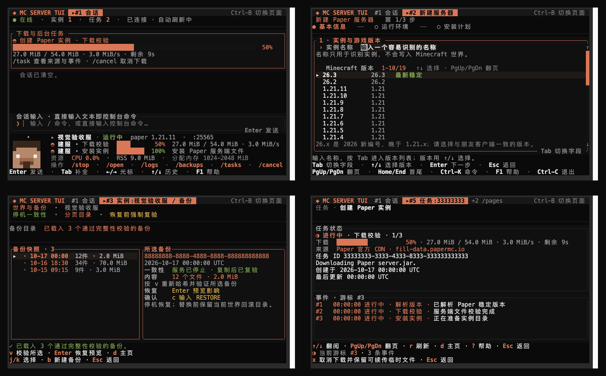
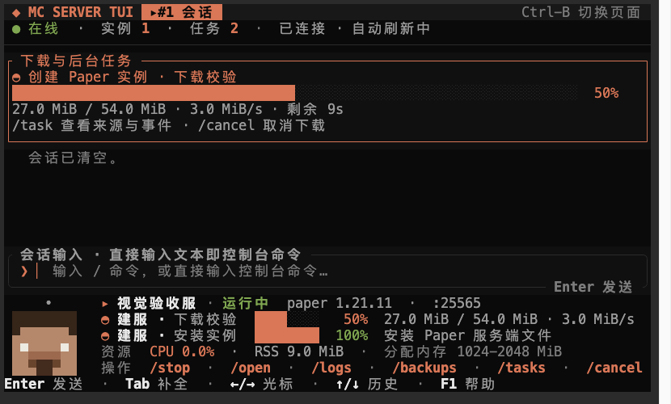
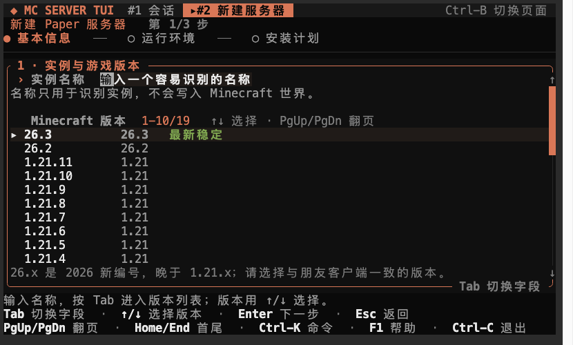
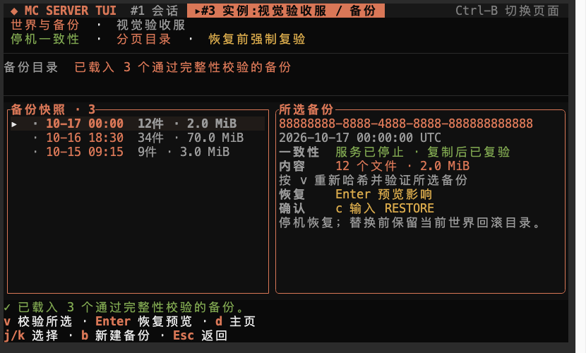
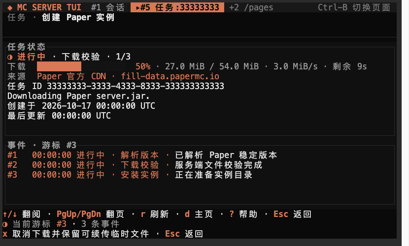
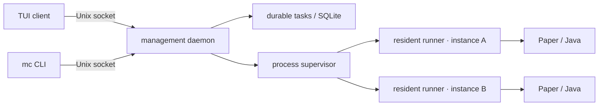

<div align="center">
  
  <h1>mc-server-tui</h1>
  <p><a href="README.zh-CN.md">简体中文</a> · <strong>English</strong></p>
  <p><strong>A terminal-first Minecraft Java server manager for macOS and Linux.</strong></p>
  <p>Guided Paper setup · Fabric creation · resident supervisor · live console · verified downloads · world backups · a Claude Code-style shell · seven themes</p>

  <p>
    <a href="https://juanwang-buaa.github.io/mc-server-tui/"></a>
    <a href="https://github.com/JUANWANG-BUAA/mc-server-tui/actions/workflows/ci.yml"></a>
    <a href="https://github.com/JUANWANG-BUAA/mc-server-tui/releases"></a>
    <a href="#license"></a>
    
    
    
  </p>
</div>

> [!WARNING]
> **v0.2.0 is an unsigned alpha pre-release.** The installer verifies the release
> manifest's SHA-256 and file size, but there is no code signature or macOS
> notarization yet. Keep independent backups of any world you care about.

Read the [bilingual user guide](https://juanwang-buaa.github.io/mc-server-tui/docs/)
for installation, everyday commands, backup and restore, troubleshooting, and
the alpha's safety limits.

## Design improvements in current source (unreleased)

The selected server and next action stay at the top; background progress appears once. Management connectivity is separate from game readiness. Console drafts show their target and cannot silently follow an instance switch. Runtime settings start with a summary; F3 expands settings, instance diagnostics, or backup evidence. Backup views lead with local restore time and impact. Existing themes, commands and classic view remain available.

These changes are not included in the v0.2.0 release. See the [interaction contract](docs/INTERACTION_DESIGN.md).

## Why another server manager?

Most Minecraft server panels assume a browser, a daemon with broad privileges,
or a workflow that hides the actual server process. `mc-server-tui` is built for
the terminal:

- **One shell for daily work.** Start, stop, watch logs, cancel a download,
  inspect a task, or send a console command without changing pages.
- **The server outlives the UI.** A per-instance resident runner owns Java's
  console and keeps running when the TUI or management daemon restarts.
- **Downloads are evidence-based.** Paper builds are locked to an exact build,
  size, and SHA-256; partial downloads resume only when the source proves the
  range is safe.
- **World safety first.** Backups are checksummed, listed in pages, verified,
  and restored through a preview + explicit confirmation + recovery journal.
- **It looks like a terminal.** Near-black palettes, restrained accent colors,
  a pixel Steve mascot, and no browser dependency.

## Features

This table describes the `v0.2.0` alpha release and its exact published scope.

| Area | What is there today |
| --- | --- |
| **Session TUI** | Transcript + composer + persistent status dock, slash-command completion, command palette, cursor editing, history, inline `/logs` and `/cancel` |
| **Server creation** | Guided Paper version/build setup plus Fabric creation with Java/port checks and explicit EULA acceptance |
| **Lifecycle** | Idempotent start, graceful stop, controlled restart, readiness detection, startup-failure diagnosis, console input, incremental logs, CPU/RSS readouts |
| **Resident supervision** | Per-instance runner, process identity markers, daemon restarts reattach without killing Java |
| **Durable tasks** | SQLite-backed queue, byte progress, speed/source, event cursors, cooperative cancellation |
| **World backups** | Stopped-world discovery, preflight, staging copy, SHA-256 manifest, paged listing, verification, restore plan/token, rollback journal |
| **Server configuration** | TUI editor for MOTD, max players, difficulty, and view distance; diff review, external-edit detection, and atomic save |
| **Modpacks** | ZIP/MRPACK preview and stopped-instance import, verified export; compatible Paper/Fabric add-on downloads and required dependencies |
| **Distribution** | `mc` launcher, `config.toml`, launchd/systemd user service, versioned installer, release manifest, Homebrew formula template |

## Screenshots

| Session shell | Guided Paper creation |
| --- | --- |
|  |  |
| **Backup manager** | **Byte-level task progress** |
|  |  |

More visual evidence, including all seven themes and the Steve animation states,
lives in [`output/playwright/`](output/playwright/).

## Quick start

### Requirements

- macOS 13+ on Apple Silicon, or Linux (x86_64 or arm64)
- Java 21 for 1.21.x; Java 25+ for 26.x (selected per Minecraft version)
- A terminal at least **80×24**; 40×12 layouts render with reduced chrome
- Network access for the first Paper download

### Install a release

`v0.2.0` is a pre-release, so GitHub's `/latest/` URL does not select it yet.
Use the tag-specific installer:

```sh
TAG=v0.2.0
curl -fsSL "https://github.com/JUANWANG-BUAA/mc-server-tui/releases/download/$TAG/install.sh" | sh
mc setup
mc
```

`mc setup` writes [`config.toml`](crates/mc-config/src/lib.rs), checks Java,
installs a launchd/systemd **user** service, starts the daemon, and leaves the
TUI to `mc`. The installer verifies SHA-256; see the warning above.

If you do not want a background service, write config only and start the daemon
in a separate terminal:

```sh
mc setup --no-service
mc daemon run   # terminal 1
mc tui          # terminal 2
```

### Build from source

```sh
git clone https://github.com/JUANWANG-BUAA/mc-server-tui.git
cd mc-server-tui
cargo build --workspace
./target/debug/mc setup --dry-run   # inspect config + service unit
./target/debug/mc setup
./target/debug/mc
```

The source-build service points at `target/debug/mc`; it is for development, not
a production install.

## Daily use

The default screen is a session shell. Type `/` for completion, or plain text to
send it to the selected instance's console.

| Command | Purpose |
| --- | --- |
| `/create` | Guided Paper server creation |
| `/open` | Instance detail: lifecycle, console, logs, backups |
| `/config` | Edit four `server.properties` fields and review the diff before saving |
| `/start`, `/stop` | Start / graceful stop the selected instance |
| `/restart` | Gracefully stop a running instance, wait for its process to exit, then start it again |
| `/logs` | Tail the last console lines inline |
| `/tasks`, `/task <n>` | Durable task list and detail |
| `/cancel [n]` | Cancel a queued/running download (the TUI asks twice) |
| `/backup`, `/backups` | Create a stopped-world backup; open the backup manager |
| `/console <command>` | Send a console command |
| `/status`, `/instances`, `/use <n>` | Inspect and select instances |
| `/theme <name>`, `F2` | Switch between seven themes |
| `/classic` | Two-panel instance/task dashboard |
| `/help`, `F1` | Keyboard and command help |

Useful keys: `Enter` send · `Tab` complete · `←/→` caret · `Home/End` line ends ·
`↑/↓` history/completion · `PgUp/PgDn` transcript · `Ctrl-K` palette ·
`F1` help · `F2` theme.

Outside the TUI:

```sh
mc status --json
mc doctor --json
mc version --json
mc cli instance list
mc cli instance start <instance-id>
mc cli instance stop <instance-id> --timeout-seconds 20
mc cli instance restart <instance-id> --timeout-seconds 20
mc service status --json
mc service restart
mc uninstall          # preserves instance data/config/cache
```


## Workspaces and server operations

The top bar shows open pages and stable page IDs. Click a page or press **Ctrl-B**, then
`n`/`p` to cycle, `w` to list, `x` to close, or `1`–`9` to jump. `/pages`, `/page <id>`,
and `/close [id]` are also available. Closing a page leaves its server running. Instance
pages retain log filters and reading positions.

- `/connect`: distinguish local, LAN and internet joining; addresses are interface candidates, not proof of reachability.
- `/monitor`: query the actual Minecraft status and player count; `/open` shows CPU/RSS history.
- `/rg [-i] [-e] <pattern>`: search current and rotated logs with file/line references; `-e` enables regex.
- In instance logs, `f` filters live output, arrows pan horizontally, and the right scrollbar supports dragging.
- `/players`: inspect OP/whitelist/bans; `list`, `op`, `deop`, `ban`, `pardon`, `kick`, `allow`, `deny`, `whitelist-on`, `whitelist-off` perform typed console actions.
- With LuckPerms installed: `/players group <name> <group>` or `/players grant|revoke <name> <permission-node>`.

Warnings cover abnormal exits, newly observed ERROR/Exception logs, sustained process CPU
(90% of one core for six samples), and RSS above configured Xmx for three samples.
**RSS includes off-heap memory and is not Java heap usage.** Alerts never automatically
restart or kill a process; graphs retain the latest 60 samples.

## Fabric, add-ons and portable server packs

```text
/fabric mod-friends 1.21.11 --accept-eula
/mods search luckperms
/mods install luckperms
/import /absolute/path/server-pack.zip
/import /absolute/path/server-pack.zip --apply
/import /absolute/path/example.mrpack --apply
/export /absolute/path/shared-server-pack.zip
```

Read https://www.minecraft.net/eula before explicitly accepting. Fabric selects a stable
loader, compatible Java and an unreserved available port, initially using 1–4 GiB.
Add-ons require a stopped instance, match the Minecraft version and loader, verify
SHA-512, resolve required catalog dependencies and detect common Fabric API module
requirements in JAR metadata. Paper accepts plugins; Fabric accepts mods. Client-only
artifacts are rejected. Start the server to load installed add-ons.

Imports preview before applying, stage and validate files, skip identical content and
reject conflicting existing files. They accept mods/plugins/config, never replace worlds,
identity lists, server.jar or server.properties, and never execute archive scripts.
Limits: 10,000 entries, 512 MiB expanded total, 256 MiB per file; traversal and symlinks
are rejected. MRPACK downloads use the official Modrinth CDN and SHA-512 checksums.
Exports are **server add-on/config bundles**, with loader/game metadata and SHA-256;
they are not client-launcher packs. Inspect deployment-specific config before sharing.
Forge/NeoForge provisioning, authorized CurseForge file-ID downloads and arbitrary
third-party dependency solving remain unsupported with explicit diagnostics.

## Architecture



The runner owns Java's stdin/stdout/stderr and a private control socket. Killing
or upgrading the management daemon does **not** kill the Minecraft process; the
new daemon reads process identity records and reattaches. This is the foundation
for future hot updates. See [Supervision](docs/SUPERVISION.md).

## Status

`v0.2.0` is the current public, unsigned alpha release. Current implementation
status (2026-10-20):

| Implemented | Next |
| --- | --- |
| Paper and Fabric install/start/stop/console/logs | Vanilla provider |
| Resident runner + daemon reattachment | Takeover of existing server directories |
| Stopped-world backup/verify/restore | Online/scheduled backups |
| Durable tasks, byte progress, cancellation | Full `server.properties` coverage and raw editor |
| Player actions (OP/whitelist/ban/kick) over typed console commands | Structured player-management results |
| Log search (`/rg`), live filtering, CPU/RSS trends and alerts | TPS/MSPT and JVM metrics |
| Workspace pages with stable IDs and preserved log state | Multi-instance scheduling and host memory budget |
| Modrinth add-on install, MRPACK/ZIP server-pack preview/import/export | Forge/NeoForge and authorized CurseForge file-ID downloads |
| Session TUI, seven themes, Steve | Signing/notarization, Homebrew tap, deb/rpm |
| API protocol 8–11 negotiation + runner protocol handshake | State schema migration and update task draining |
| Controlled restart and actionable startup-failure diagnosis | Broader property coverage and a real client join drill |
| Four-field `server.properties` editor with diff review and conflict detection | More properties and raw editing |
| Versioned `mc update status/rollback` | Signed self-updater with health checks |

The full documented-vs-implemented audit is in
[Implementation gaps](docs/IMPLEMENTATION_GAPS.md). The next milestone still
needs a roadmap decision: product review prioritizes one verified Paper user
journey, while earlier release planning prioritizes signed, package-managed
distribution.

## Documentation

| Start here | Deep dives |
| --- | --- |
| [Website](https://juanwang-buaa.github.io/mc-server-tui/) | Screenshots, theme switcher, architecture, install |
| [User guide](docs/USER_GUIDE.md) | Complete Markdown tutorial from install to recovery |
| [中文使用手册](docs/USER_GUIDE.zh-CN.md) | 从安装到备份恢复、排错与安全边界 |
| [Online documentation](https://juanwang-buaa.github.io/mc-server-tui/docs/) | Native bilingual guide with chapter navigation |
| [Documentation index](docs/README.md) | Every contract in one place |
| [FAQ](docs/FAQ.md) | Java, service, data paths, alpha limits |
| [Interaction design](docs/INTERACTION_DESIGN.md) | Shell/overlay/drill-in hierarchy, themes, mascot |
| [Supervision](docs/SUPERVISION.md) | Runner ownership, PID identity, daemon reattachment |
| [Instance schema](docs/INSTANCE_SCHEMA.md) | `instance.toml`, `lock.json`, SQLite index, recovery |
| [Async concurrency](docs/ASYNC_CONCURRENCY.md) | Request path, bounded tasks, cancellation |
| [Backup & restore](docs/BACKUP_RESTORE_DESIGN.md) | Transaction, verification, confirmation token |
| [Distribution](docs/DISTRIBUTION.md) | macOS/Linux packaging, services, signing, hot update |
| [Release process](docs/RELEASING.md) | Tag → CI → draft release → review |
| [Changelog](CHANGELOG.md) | User-facing changes and known alpha limitations |
| [0.2.0 release notes](docs/releases/0.2.0.md) | Current unsigned alpha |
| [0.1.0 release notes](docs/releases/0.1.0.md) | First public unsigned alpha |
| [TUI testing](docs/TUI_TESTING.md) | Renderer, PTY, screenshots, visual review |
| [Product design](PRODUCT_DESIGN.md) | Scope and release gates |
| [Implementation gaps](docs/IMPLEMENTATION_GAPS.md) | What is still missing |

## Development

The repository pins Rust **1.89.0** in [`rust-toolchain.toml`](rust-toolchain.toml).

```sh
cargo fmt --all --check
cargo clippy --workspace --all-targets -- -D warnings
cargo test --workspace
cargo build --workspace
```

Current automated evidence on macOS (2026-10-20): **217 workspace tests**,
including **91 `mc-tui` tests**. Linux remains in the CI matrix but was not
re-run in this local verification. Four PTY scripts are under
[`scripts/`](scripts/):

```sh
python3 scripts/tui_pty_smoke.py
python3 scripts/tui_guided_create_pty.py
python3 scripts/tui_task_detail_pty.py
python3 scripts/tui_instance_detail_pty.py
```

An isolated real Paper 1.21.11 drill also replaced a running PID 3482 server
with PID 3565, waited for readiness, and stopped it with exit code 0. The
original instance was copied read-only and left untouched.

The repository Cargo configuration keeps compiler and test output colored. The
TUI itself still respects the user's `NO_COLOR` preference.

Release tooling:

```sh
cargo build --workspace --release
# macOS Apple Silicon; use the matching target for other hosts
python3 scripts/package_release.py \
  --version 0.2.0 --target aarch64-apple-darwin \
  --base-url "file://$PWD/dist/0.2.0"
./scripts/install.sh --manifest-url "file://$PWD/dist/0.2.0/release-manifest.json" \
  --prefix /tmp/mcst-prefix --root /tmp/mcst-root
/tmp/mcst-prefix/bin/mc uninstall
```

See [Release process](docs/RELEASING.md) for tag-driven CI/CD and the draft
release checklist.

## Project layout

| Crate / directory | Responsibility |
| --- | --- |
| `mc-core` | domain types, errors, provider contract, API envelopes |
| `mc-client` | bounded async Unix-socket client |
| `mc-config` | `config.toml`, platform paths, User-Agent defaults |
| `mc-daemon` | local API transport, dispatch, tasks, supervisor wiring |
| `mc-supervisor` | resident runner, Java lifecycle, PID identity, console/logs |
| `mc-instance` | instance config/lock files, staging, SQLite index, recovery |
| `mc-task` | durable task/event storage, bounded workers, cancellation |
| `mc-backup` | stopped-world backup, checksums, restore transaction |
| `mc-modpack` | `.mrpack` analysis and server-pack planning |
| `provider-paper` | Paper Fill v3 metadata resolution |
| `mc-download` | verified HTTPS downloads, resume, cache, hash checks |
| `mc-system` | Java discovery, doctor, disk/port checks |
| `mc-tui` | session shell, wizard, detail pages, themes, mascot |
| `mc-cli` | text CLI over the daemon API |
| `mc` | stable launcher, setup, service, version/status, uninstall |
| `site/` | static GitHub Pages landing page (no build step) |
| `scripts/` | PTY fake daemons, visual probes, release/install tooling |

## Contributing

Read [CONTRIBUTING.md](CONTRIBUTING.md) before opening a PR. The most useful
contributions right now are:

- Vanilla provider and existing-directory takeover;
- broader `server.properties` editing, raw mode, and startup-failure diagnostics;
- online/scheduled backups and post-restore in-game verification;
- state migration, update draining, and isolated real-daemon E2E in CI;
- Linux host validation and packaging;
- focused TUI interaction fixes with before/after screenshots.

Use the issue templates for bugs/features. Do not open a public issue for a
vulnerability; follow [SECURITY.md](SECURITY.md).

## License

Dual-licensed under either of:

- [MIT](LICENSE-MIT)
- [Apache License 2.0](LICENSE-APACHE)

at your option. Contributions are accepted under the same dual license.

`mc-server-tui` is an independent project. It is not affiliated with Mojang,
Microsoft, or PaperMC. Minecraft is a trademark of Mojang Synergies AB.

<sub>Minecraft server manager · PaperMC · Rust TUI · Ratatui · terminal dashboard · macOS · Linux · self-hosted · server supervision · world backups</sub>
