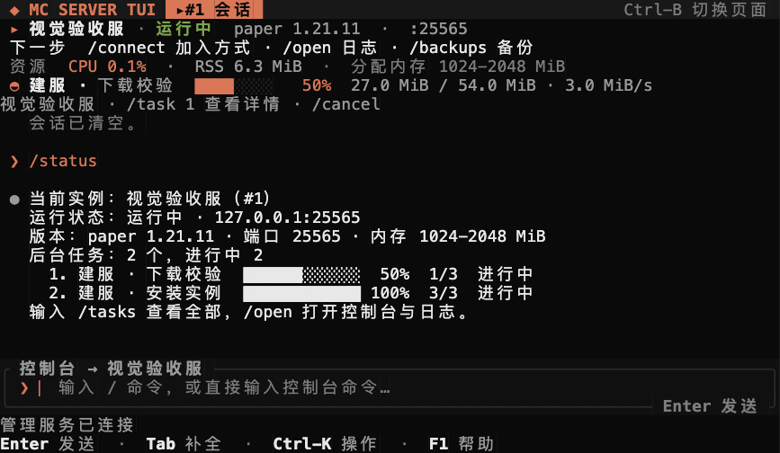

<div align="center">


# mc-server-tui

**好世界，值得一直在线。**

在 macOS 与 Linux 终端里，管理你的 Paper 和 Fabric 服务器。

[中文官网](https://juanwang-buaa.github.io/mc-server-tui/zh-CN/) · [使用教程](https://juanwang-buaa.github.io/mc-server-tui/docs/zh-CN/) · [English](README.md) · [v0.2.2](https://github.com/JUANWANG-BUAA/mc-server-tui/releases/tag/v0.2.2)



</div>

上图是使用确定性演示数据的 v0.2.1 真实 TUI 截图；v0.2.2 沿用此会话布局。

## 安装，创建第一个服务器

需要 macOS 13+ Apple Silicon 或 GNU Linux x86_64/arm64、80×24 终端，
以及匹配游戏版本的 Java。应用对 1.21.x 推荐 Java 21，对 26.x 推荐 Java 25+。
Paper 向导检测已有 Java，不自动安装运行时。

```sh
TAG=v0.2.2
curl -fsSL "https://github.com/JUANWANG-BUAA/mc-server-tui/releases/download/$TAG/install.sh" | sh
mc setup
mc
```

输入 `/create` 或点击欢迎页的 Paper 入口。选择精确游戏版本，确认 Java、内存和端口，
亲自接受 Minecraft EULA。`/tasks` 显示创建完成后：

```text
/instances
/use <序号或名称>
/start
/connect
```

等待 Minecraft 显示就绪，再用匹配版本的 Java 客户端连接。
[完整教程](docs/USER_GUIDE.zh-CN.md)包含每一步的预期结果和失败处理。
找不到 `mc` 时，执行 `export PATH="$HOME/.local/bin:$PATH"`。
Fabric 使用 `/fabric MyFabricServer 1.21.11 --accept-eula`，请先阅读并同意 EULA。
点击 Fabric 入口只填入可编辑草稿，不会自动提交。

**v0.2.2 是未签名 alpha pre-release。** 安装器校验 SHA-256 与文件大小，
没有代码签名或 macOS 公证。重要世界请保留独立备份；alpha 不承诺生产稳定性或恢复成功。

## 现在能做什么

| 流程 | 当前行为 |
| --- | --- |
| 建服 | Paper 引导创建；Fabric 独立命令；精确游戏版本与明确 EULA 确认 |
| 运行 | 启动、优雅停服、受控重启、控制台、增量日志、CPU/RSS、玩家操作 |
| 导航 | 当前实例摘要、绑定目标的草稿、工作区、七主题、命令面板 |
| 排错 | 实际原因、恢复建议、可展开证据、可滚动弹窗；保留草稿 |
| 备份 | 停服快照、SHA-256 清单、校验、恢复预览与明确确认 |
| 配置 | 四项常用属性、差异预览、外部修改冲突检测、原子保存 |
| 扩展 | 兼容 Paper/Fabric 扩展；ZIP/MRPACK 检查与停服导入 |
| 安装 | 当前用户启动器、配置、launchd/systemd 用户服务定义、版本化产物 |

每个实例都有常驻 runner，关闭 TUI 或重启管理 daemon 不会停止 Java。
**任务历史会持久保存，未完成任务不会在 daemon 重启后自动继续。**
它们会变为 `interrupted`；下载文件续传是另一项能力。

## 一次学会一条流程

| 目标 | 从这里开始 |
| --- | --- |
| 安装、建服与连接 | [快速开始](docs/QUICK_START.md) / [完整教程](docs/USER_GUIDE.zh-CN.md) |
| 保护与恢复世界 | [备份教程](docs/USER_GUIDE.zh-CN.md#8-备份与恢复) |
| 找到失败原因 | [故障排查速查](docs/TROUBLESHOOTING_CHEATSHEET.md) |
| 了解范围与证据 | [本版验收](docs/acceptance/0.2.2.md) / [当前差距](docs/IMPLEMENTATION_GAPS.md) |
| 参与开发或打包 | [文档索引](docs/README.md) / [发布流程](docs/RELEASING.md) |

Vanilla、接管现有目录、在线/定时备份、Forge/NeoForge、签名发布与签名自动更新器仍待实现。
Linux 产物在 CI 构建；真实 Linux 用户服务演练、客户端进入恢复世界核验仍待完成。
`/connect` 提供地址提示，不证明公网可连接。

## 源码构建与验证

仓库固定 Rust 1.89.0。官网使用 Python 标准库及原生 HTML/CSS/JavaScript，
不需要安装前端依赖。

```sh
cargo build --workspace --locked
./target/debug/mc setup
./target/debug/mc
```

前台运行时，先执行 `mc setup --no-service`，再在两个终端分别运行
`mc daemon run` 和 `mc tui`。CLI 生命周期命令使用实例 UUID：
先执行 `mc cli instance list`，再执行 `mc cli instance start <UUID>`。

```sh
cargo fmt --all --check
cargo clippy --workspace --all-targets --all-features --locked -- -D warnings
cargo test --workspace --all-targets --locked
cargo test --workspace --doc --locked
python3 scripts/build_landing_site.py
python3 scripts/build_docs_site.py
python3 scripts/check_docs.py
python3 scripts/check_protocol_window.py
python3 scripts/test_first_time_experience.py
```

本机 macOS 基线为 258 项测试，其中 TUI 104 项，另有五套 PTY 流程。
[本版验收](docs/acceptance/0.2.2.md)分别记录模拟 daemon 交互检查、
历史真实 Paper 演练与远程 CI，避免混淆验证范围。

## 运行原理

TUI / CLI 通过私有 Unix socket 访问管理 daemon；daemon 协调实例配置、持久任务、
备份恢复与每实例 runner。runner 独立持有 Java 进程、控制台和日志。
`mc doctor --json` 可查看实际配置与数据路径。

实现契约见[监督机制](docs/SUPERVISION.md)、[实例结构](docs/INSTANCE_SCHEMA.md)
和[备份设计](docs/BACKUP_RESTORE_DESIGN.md)。

## 参与与许可证

请阅读 [CONTRIBUTING](CONTRIBUTING.md)、[SECURITY](SECURITY.md) 和
[行为准则](CODE_OF_CONDUCT.md)。项目采用 [MIT](LICENSE-MIT) OR [Apache-2.0](LICENSE-APACHE)。

本项目与 Mojang、Microsoft、PaperMC、Modrinth、Fabric、Forge 无隶属关系。
Minecraft 是 Mojang Synergies AB 的商标。EULA、第三方许可证、托管权限和世界备份由使用者负责。
