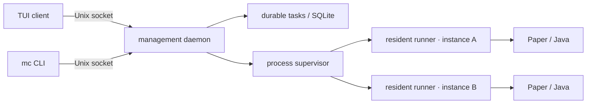

<div align="center">
  <a href="README.md">English</a> · <strong>简体中文</strong> · <a href="https://juanwang-buaa.github.io/mc-server-tui/">官网</a>
  
  <h1>mc-server-tui</h1>
  <p><strong>面向 macOS / Linux 的终端优先 Minecraft Java 服务端管理器。</strong></p>
  <p>Paper 引导建服 · 常驻 runner · 实时控制台 · 校验下载 · 世界备份 · Claude Code 风格会话 · 七套主题</p>
</div>

> [!WARNING]
> **v0.1.0 是未签名的 alpha pre-release。** 安装器只校验 release manifest 的
> SHA-256 和文件大小，没有代码签名或 macOS 公证。请始终为重要世界保留独立备份。

## 为什么做这个项目

Minecraft 服务端管理工具通常要求浏览器面板、较宽的系统权限，或者把真正的
Java 进程藏在多层封装之后。这个项目选择终端：

- **日常管理留在一个 shell 里**：启停、日志、下载取消、任务查看、控制台命令
  不需要反复切页。
- **服务端不依赖 UI 存活**：每个实例有独立 runner，TUI 或 daemon 重启不会
  杀掉 Java；新 daemon 会按进程身份重新连接。
- **下载可追溯**：Paper 构建锁定到精确 build、大小和 SHA-256；断点续传只在
  来源证明 Range 安全时继续。
- **世界安全优先**：备份有 SHA-256 清单、分页校验、恢复预览、精确确认和
  recovery journal。
- **像终端工具**：近黑背景、克制的强调色、像素史蒂夫，没有浏览器依赖。

## 当前功能

| 模块 | 当前状态 |
| --- | --- |
| 会话 TUI | transcript + composer + 状态坞、命令补全、命令面板、光标编辑、历史、内联 `/logs`/`/cancel` |
| Paper 建服 | 版本/build 选择、滚动条、Java 绑定、内存/端口、EULA、计划预览 |
| 生命周期 | 幂等启动、优雅停止、就绪识别、控制台、增量日志、CPU/RSS |
| 常驻监督 | per-instance runner、进程身份、daemon 重启重连 |
| 持久任务 | SQLite 任务、字节进度、速度/来源、事件游标、协作取消 |
| 世界备份 | 停服备份、预检、staging、校验、恢复计划/token、恢复 journal |
| 整合包 | `.mrpack` 只读分析：MC 版本、loader、`env.server`、路径安全、hash、下载域名 |
| 分发 | `mc` 启动器、`config.toml`、launchd/systemd 用户服务、版本化安装器、release manifest、Homebrew formula 模板 |

## 快速开始

要求：macOS 13+ 或 Linux x86_64/arm64；Java 21+；终端至少 80×24；首次下载
Paper 需要网络。

```sh
# v0.1.0 是 pre-release，/latest/ 暂时不会选中它，使用 tag-specific URL
TAG=v0.1.0
curl -fsSL "https://github.com/JUANWANG-BUAA/mc-server-tui/releases/download/$TAG/install.sh" | sh
mc setup
mc
```

`mc setup` 会写 `config.toml`、检查 Java、安装 launchd/systemd **用户级**服务、
启动 daemon，然后提示运行 `mc` 进入 TUI。

不安装后台服务：

```sh
mc setup --no-service
mc daemon run   # 终端 1
mc tui          # 终端 2
```

从源码构建：

```sh
git clone https://github.com/JUANWANG-BUAA/mc-server-tui.git
cd mc-server-tui
cargo build --workspace
./target/debug/mc setup --dry-run
./target/debug/mc setup
./target/debug/mc
```

源码构建的服务指向 `target/debug/mc`，只适合开发验证。

## 日常命令

默认是会话 shell，输入 `/` 补全；直接输入文本会发送到当前实例控制台。

| 命令 | 作用 |
| --- | --- |
| `/create` | Paper 引导建服 |
| `/open` | 实例详情：生命周期、控制台、日志、备份 |
| `/start`、`/stop` | 启动 / 优雅停止 |
| `/logs` | 在会话内查看最近日志 |
| `/tasks`、`/task <n>` | 任务列表 / 详情 |
| `/cancel [n]` | 取消下载，TUI 会二次确认 |
| `/backup`、`/backups` | 停服备份 / 备份管理器 |
| `/console <命令>` | 发送控制台命令 |
| `/status`、`/instances`、`/use <n>` | 查看 / 选择实例 |
| `/theme <name>`、`F2` | 切换七套主题 |
| `/classic` | 经典双面板 |
| `/help`、`F1` | 帮助 |

常用按键：`Enter` 发送 · `Tab` 补全 · `←/→` 光标 · `Home/End` 行首尾 ·
`↑/↓` 历史/补全 · `PgUp/PgDn` 会话 · `Ctrl-K` 命令面板 · `F1` 帮助 · `F2` 主题。

TUI 外：

```sh
mc status --json
mc doctor --json
mc version --json
mc service status --json
mc service restart
mc uninstall          # 保留实例数据/配置/cache
```

## 架构



runner 持有 Java 的 stdin/stdout/stderr 和私有控制 socket。TUI 或 daemon 重启
不会杀掉 Minecraft；新 daemon 读取进程身份记录并重连。详见
[Supervision](docs/SUPERVISION.md)。

## 状态

`v0.1.0` 是 alpha。当前只支持 Paper 的完整闭环；Vanilla、接管现有目录、
`server.properties`、玩家管理、在线/定时备份仍在路线图上。

| 已实现 | 下一步 |
| --- | --- |
| Paper 安装/启停/控制台/日志 | Vanilla provider |
| 常驻 runner + daemon 重连 | 接管现有服务端目录 |
| 停服备份/校验/恢复 | 在线/定时备份 |
| 持久任务、字节进度、取消 | 玩家管理 |
| 会话 TUI、七主题、史蒂夫 | `server.properties` 编辑 |
| 用户服务 + 版本化安装器 | 签名/公证、Homebrew tap、deb/rpm |
| `.mrpack` 只读分析 | Fabric/整合包真正物化导入 |

完整差距见 [Implementation gaps](docs/IMPLEMENTATION_GAPS.md)。

## 文档

- [官网](https://juanwang-buaa.github.io/mc-server-tui/)
- [文档索引](docs/README.md)
- [FAQ](docs/FAQ.md)
- [交互设计](docs/INTERACTION_DESIGN.md)
- [进程监督](docs/SUPERVISION.md)
- [实例 schema](docs/INSTANCE_SCHEMA.md)
- [异步并发](docs/ASYNC_CONCURRENCY.md)
- [备份恢复](docs/BACKUP_RESTORE_DESIGN.md)
- [分发设计](docs/DISTRIBUTION.md)
- [发布流程](docs/RELEASING.md)
- [TUI 测试](docs/TUI_TESTING.md)
- [实现差距](docs/IMPLEMENTATION_GAPS.md)

## 开发

仓库在 `rust-toolchain.toml` 中固定 Rust **1.89.0**。

```sh
cargo fmt --all --check
cargo clippy --workspace --all-targets -- -D warnings
cargo test --workspace
cargo build --workspace
```

当前自动化证据：macOS **164** 项测试，Linux **165** 项（多一个
`systemd-analyze` 单元校验），另有四个 PTY 脚本：

```sh
python3 scripts/tui_pty_smoke.py
python3 scripts/tui_guided_create_pty.py
python3 scripts/tui_task_detail_pty.py
python3 scripts/tui_instance_detail_pty.py
```

## 贡献与安全

- 提交前阅读 [CONTRIBUTING.md](CONTRIBUTING.md)。
- 漏洞请走私密 GitHub Security Advisory，见 [SECURITY.md](SECURITY.md)。
- 不要公开世界文件、token、私密 IP 或包含个人信息的日志。

## 许可证

本项目采用 **MIT OR Apache-2.0** 双许可，任选其一：

- [MIT](LICENSE-MIT)
- [Apache License 2.0](LICENSE-APACHE)

贡献按 MIT 或 Apache-2.0 双许可接收。

本项目是独立项目，与 Mojang、Microsoft、PaperMC 无隶属关系。Minecraft 是
Mojang Synergies AB 的商标。

<sub>Minecraft 服务端管理器 · PaperMC · Rust TUI · Ratatui · 终端面板 · macOS · Linux · 自托管 · 进程监督 · 世界备份</sub>
