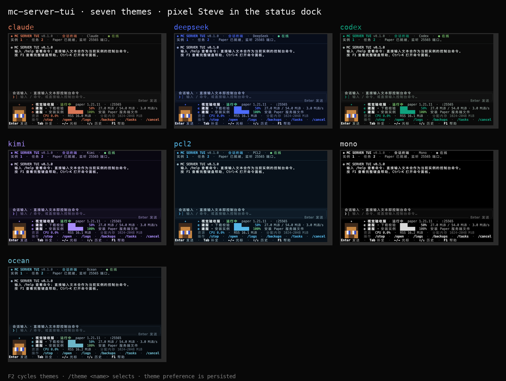
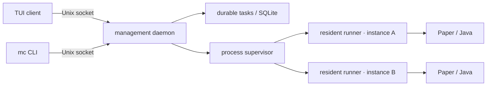

<div align="center">
  <a href="README.md">English</a> · <strong>简体中文</strong> · <a href="https://juanwang-buaa.github.io/mc-server-tui/">官网</a>
  
  <h1>mc-server-tui</h1>
  <p><strong>面向 macOS / Linux 的终端优先 Minecraft Java 服务端管理器。</strong></p>
  <p>Paper 引导建服 · Fabric 建服 · 常驻 runner · 实时控制台 · 校验下载 · 世界备份 · Claude Code 风格会话 · 七套主题</p>
</div>

> [!WARNING]
> **v0.2.0 是未签名的 alpha pre-release。** 安装器只校验 release manifest 的
> SHA-256 和文件大小，没有代码签名或 macOS 公证。请始终为重要世界保留独立备份。

## 为什么做这个项目

Minecraft 服务端管理工具通常要求浏览器面板、较宽的系统权限，或者把真正的
Java 进程藏在多层封装之后。这个项目选择终端：

- **日常管理留在一个 shell 里**：启停、日志、下载取消、任务查看、控制台命令
  不需要反复切页。
- **服务端不依赖 UI 存活**：每个实例有独立 runner，TUI 或 daemon 重启不会
  杀掉 Java；新 daemon 会按进程身份重新连接。
- **下载可追溯**：Paper 构建锁定到精确 build、大小和 SHA-256；断点续传只在
  来源证明 Range 安全时继续。
- **世界安全优先**：备份有 SHA-256 清单、分页校验、恢复预览、精确确认和
  recovery journal。
- **像终端工具**：近黑背景、克制的强调色、像素史蒂夫，没有浏览器依赖。

## 当前功能

下表描述 `v0.2.0` alpha 发行版的实际范围。

| 模块 | 当前状态 |
| --- | --- |
| 会话 TUI | transcript + composer + 状态坞、命令补全、命令面板、光标编辑、历史、内联 `/logs`/`/cancel` |
| 建服 | Paper 版本/build 向导，以及带 Java/端口检查和明确 EULA 的 Fabric 建服 |
| 生命周期 | 幂等启动、优雅停止、受控重启、就绪识别、启动失败诊断、控制台、增量日志、CPU/RSS |
| 常驻监督 | per-instance runner、进程身份、daemon 重启重连 |
| 持久任务 | SQLite 任务、字节进度、速度/来源、事件游标、协作取消 |
| 世界备份 | 停服备份、预检、staging、校验、恢复计划/token、恢复 journal |
| 服务端配置 | MOTD、人数上限、难度和视距编辑；差异预览、外部修改检测与原子保存 |
| 整合包 | ZIP / MRPACK 预览与停服导入、校验导出；Paper / Fabric 兼容扩展下载及必需依赖 |
| 分发 | `mc` 启动器、`config.toml`、launchd/systemd 用户服务、版本化安装器、release manifest、Homebrew formula 模板 |

## 快速开始

要求：macOS 13+ 或 Linux x86_64/arm64；Java 21（1.21.x）/ Java 25+（26.x）；终端至少 80×24；首次下载
Paper 需要网络。

```sh
# v0.2.0 是 pre-release，/latest/ 暂时不会选中它，使用 tag-specific URL
TAG=v0.2.0
curl -fsSL "https://github.com/JUANWANG-BUAA/mc-server-tui/releases/download/$TAG/install.sh" | sh
mc setup
mc
```

`mc setup` 会写 `config.toml`、检查 Java、安装 launchd/systemd **用户级**服务、
启动 daemon，然后提示运行 `mc` 进入 TUI。

不安装后台服务：

```sh
mc setup --no-service
mc daemon run   # 终端 1
mc tui          # 终端 2
```

从源码构建：

```sh
git clone https://github.com/JUANWANG-BUAA/mc-server-tui.git
cd mc-server-tui
cargo build --workspace
./target/debug/mc setup --dry-run
./target/debug/mc setup
./target/debug/mc
```

源码构建的服务指向 `target/debug/mc`，只适合开发验证。

## 日常命令

默认是会话 shell，输入 `/` 补全；直接输入文本会发送到当前实例控制台。

| 命令 | 作用 |
| --- | --- |
| `/create` | Paper 引导建服 |
| `/open` | 实例详情：生命周期、控制台、日志、备份 |
| `/config` | 编辑四类 `server.properties` 字段，保存前检查差异 |
| `/start`、`/stop` | 启动 / 优雅停止 |
| `/restart` | 优雅停止并等待旧进程退出，再启动同一实例 |
| `/logs` | 在会话内查看最近日志 |
| `/tasks`、`/task <n>` | 任务列表 / 详情 |
| `/cancel [n]` | 取消下载，TUI 会二次确认 |
| `/backup`、`/backups` | 停服备份 / 备份管理器 |
| `/console <命令>` | 发送控制台命令 |
| `/status`、`/instances`、`/use <n>` | 查看 / 选择实例 |
| `/theme <name>`、`F2` | 切换七套主题 |
| `/classic` | 经典双面板 |
| `/help`、`F1` | 帮助 |

常用按键：`Enter` 发送 · `Tab` 补全 · `←/→` 光标 · `Home/End` 行首尾 ·
`↑/↓` 历史/补全 · `PgUp/PgDn` 会话 · `Ctrl-K` 命令面板 · `F1` 帮助 · `F2` 主题。

TUI 外：

```sh
mc status --json
mc doctor --json
mc version --json
mc cli instance list
mc cli instance start <实例 ID>
mc cli instance stop <实例 ID> --timeout-seconds 20
mc cli instance restart <实例 ID> --timeout-seconds 20
mc service status --json
mc service restart
mc uninstall          # 保留实例数据/配置/cache
```


## 工作区、日志与玩家管理

页面使用稳定编号；顶部显示当前页和总数，鼠标可点击切换。按 **Ctrl-B** 后再按
`n` / `p` 切换、`w` 列表、`x` 关闭、`1`–`9` 跳转。`/pages`、`/page <编号>`、
`/close [编号]` 也可使用。关闭页面不会停止服务端；实例日志的过滤和滚动位置会保留。

| 命令 | 用途 |
| --- | --- |
| `/connect` | 区分本机、局域网和外网加入方式；接口地址不代表外网已连通 |
| `/monitor` | 实际 Minecraft 状态查询和在线人数；`/open` 查看 CPU / RSS 趋势 |
| `/rg [-i] [-e] <模式>` | 搜索当前和上一份轮转日志；`-i` 忽略大小写，`-e` 正则；返回文件与行号 |
| `/players` | 查看 OP、白名单、封禁名单和操作说明 |
| `/players list` | 查询在线玩家并显示服务端反馈 |
| `/players op\|deop\|ban\|pardon\|kick <玩家> [原因]` | 玩家管理；OP 是全面管理权限 |
| `/players allow\|deny <玩家>` | 白名单增删；`whitelist-on` / `whitelist-off` 开关 |
| `/players group <玩家> <组>` | LuckPerms 权限组；`grant` / `revoke <玩家> <节点>` 分配细粒度权限 |

实例日志按级别着色；`f` 实时文字过滤，`←` / `→` 横向查看，拖动右侧滚动条可跳转。
CPU 连续 6 次采样达到单核 90%、RSS 连续 3 次超过配置的 Xmx，以及异常退出、近期
ERROR / Exception 会产生提示。**RSS 包含堆外内存，并不等于 Java 堆使用量**；这些提示
不会自动重启或结束进程。趋势图展示最近 60 次采样。

## 模组与服务端整合包

```sh
# 在 TUI 中执行；先阅读 https://www.minecraft.net/eula
/fabric mod-friends 1.21.11 --accept-eula
/mods search luckperms
/mods install luckperms
```

Fabric 自动选择稳定 Loader 和兼容 Java，初始内存 1–4 GiB；在创建向导或已有实例
占用的端口会跳过。安装扩展要求停服，按 Minecraft 版本和加载器筛选、校验 SHA-512，
解析必需依赖，并识别 JAR 中常见的 Fabric API 模块依赖。Paper 只装插件，Fabric 只装模组；
客户端专用文件会拒绝。安装后需要启动才能加载，不执行热加载。

```sh
/import /绝对路径/server-pack.zip            # 只预览
/import /绝对路径/server-pack.zip --apply    # 停服后添加扩展与配置
/import /绝对路径/example.mrpack --apply
/export /绝对路径/shared-server-pack.zip
```

ZIP 支持 `mods/*.jar`、`plugins/*.jar`、`config/`，以及常见的单层目录封装。
MRPACK 读取服务端环境标记，并从 Modrinth CDN 下载、校验 SHA-512；不支持的加载器、
CurseForge 客户端文件 ID 清单会明确拒绝。导入先暂存和校验，已有同内容跳过、不同内容
冲突拒绝，不覆盖世界、玩家身份数据、server.jar 或 server.properties，不执行包内脚本。
限制为 10000 项、展开总量 512 MiB、单文件 256 MiB，并拒绝越界路径与符号链接。

导出的是**服务端扩展与配置包**，含版本/加载器和 SHA-256 清单，不包含世界、玩家名单
或服务端核心，不是客户端启动器格式。配置可能含部署者自己的连接信息，分享前应检查。
Forge / NeoForge 建服、CurseForge API 授权下载和自动解决任意第三方依赖尚未提供。

## 架构



runner 持有 Java 的 stdin/stdout/stderr 和私有控制 socket。TUI 或 daemon 重启
不会杀掉 Minecraft；新 daemon 读取进程身份记录并重连。详见
[Supervision](docs/SUPERVISION.md)。

## 状态

`v0.2.0` 是当前公开的 unsigned alpha。截至 2026-10-20，实现状态如下：

| 已实现 | 下一步 |
| --- | --- |
| Paper / Fabric 安装、启停、控制台、日志 | Vanilla provider |
| 常驻 runner + daemon 重连 | 接管现有服务端目录 |
| 停服备份/校验/恢复 | 在线/定时备份 |
| 持久任务、字节进度、取消 | 完整 `server.properties` 覆盖与原始编辑 |
| 玩家操作（OP/白名单/封禁/踢出） | 结构化玩家管理结果 |
| `/rg` 日志搜索、实时过滤、CPU/RSS 趋势与告警 | TPS/MSPT 与 JVM 指标 |
| 工作区多页面、稳定编号、日志状态保留 | 多实例调度与主机内存预算 |
| Modrinth 扩展安装、MRPACK/ZIP 整合包预览/导入/导出 | Forge / NeoForge 与 CurseForge 文件 ID 授权导入 |
| 会话 TUI、七主题、史蒂夫 | 签名/公证、Homebrew tap、deb/rpm |
| API 协议 8–11 协商 + runner 协议握手 | 状态 schema 迁移与更新前任务排空 |
| 受控重启与可执行的启动失败诊断 | 更完整属性管理与真实客户端加入演练 |
| 四字段 `server.properties` 编辑、差异预览与冲突检测 | 更多属性与原始编辑 |
| 版本化 `mc update status/rollback` | 带健康检查的签名自动更新器 |

完整差距见 [Implementation gaps](docs/IMPLEMENTATION_GAPS.md)。
下一里程碑仍需明确路线：产品评审建议先验证完整 Paper 服主旅程，较早的发布规划则优先签名和包管理分发。

## 文档

- [官网](https://juanwang-buaa.github.io/mc-server-tui/)
- [文档索引](docs/README.md)
- [FAQ](docs/FAQ.md)
- [交互设计](docs/INTERACTION_DESIGN.md)
- [进程监督](docs/SUPERVISION.md)
- [实例 schema](docs/INSTANCE_SCHEMA.md)
- [异步并发](docs/ASYNC_CONCURRENCY.md)
- [备份恢复](docs/BACKUP_RESTORE_DESIGN.md)
- [分发设计](docs/DISTRIBUTION.md)
- [发布流程](docs/RELEASING.md)
- [0.2.0 发布说明](docs/releases/0.2.0.md)
- [TUI 测试](docs/TUI_TESTING.md)
- [实现差距](docs/IMPLEMENTATION_GAPS.md)

## 开发

仓库在 `rust-toolchain.toml` 中固定 Rust **1.89.0**。

```sh
cargo fmt --all --check
cargo clippy --workspace --all-targets -- -D warnings
cargo test --workspace
cargo build --workspace
```

当前本机自动化证据（macOS，2026-10-20）：workspace **217** 项测试，
其中 `mc-tui` **91** 项。Linux 仍在 CI 矩阵内，但本次未在本机重跑；另有四个 PTY 脚本：

```sh
python3 scripts/tui_pty_smoke.py
python3 scripts/tui_guided_create_pty.py
python3 scripts/tui_task_detail_pty.py
python3 scripts/tui_instance_detail_pty.py
```

另完成隔离的真实 Paper 1.21.11 重启演练：运行中的 PID 3482 被 PID 3565 替代，
新进程再次就绪后优雅停止，退出码为 0；原始实例仅只读复制，未被启动或修改。

仓库的 Cargo 配置固定保留彩色编译与测试输出；TUI 本身仍尊重用户的 `NO_COLOR` 偏好。

## 贡献与安全

- 提交前阅读 [CONTRIBUTING.md](CONTRIBUTING.md)。
- 漏洞请走私密 GitHub Security Advisory，见 [SECURITY.md](SECURITY.md)。
- 不要公开世界文件、token、私密 IP 或包含个人信息的日志。

## 许可证

本项目采用 **MIT OR Apache-2.0** 双许可，任选其一：

- [MIT](LICENSE-MIT)
- [Apache License 2.0](LICENSE-APACHE)

贡献按 MIT 或 Apache-2.0 双许可接收。

本项目是独立项目，与 Mojang、Microsoft、PaperMC 无隶属关系。Minecraft 是
Mojang Synergies AB 的商标。

<sub>Minecraft 服务端管理器 · PaperMC · Rust TUI · Ratatui · 终端面板 · macOS · Linux · 自托管 · 进程监督 · 世界备份</sub>
