# TUI feedback and test loop

The TUI uses the daemon API and durable task event cursor; rendering and input handling stay separate from daemon I/O. This makes the UI testable without contacting Paper or waiting on real downloads.

## Module boundaries and visual behavior

Keep the TUI split along responsibilities so screen growth does not turn the runtime into a screen-sized module:

- `app.rs` owns the screen-level state and action transitions. Feature state and behavior that need their own lifecycle belong in `app/`, `instance_detail.rs`, `backup_manager.rs`, `task_detail.rs`, or `wizard.rs` with colocated tests.
- `runtime.rs` owns the async event loop, request scheduling, and result delivery. Key mapping is isolated in `runtime/input.rs`; daemon access is behind `ManagementSource` in `source.rs`.
- `shell_view.rs` and `transcript.rs` own the default session shell: transcript, composer, inline command completion, and the status dock. `shell.rs` owns the static slash-command catalog and fuzzy completion. `app/shell.rs` owns command dispatch and transcript appends.
- `view.rs` routes to the session shell, classic dashboard, wizard, task-detail, instance-detail, and world-backup renderers. Each screen renderer owns its layout and presentation, while `theme.rs` is the single palette and shared-style boundary.
- `theme.rs` carries three near-black palettes (`Claude`, `Mono`, `Ocean`). The selected theme is process-global, switched with `F2` or `/theme`, saved under the platform config directory, and overridable with `MC_SERVER_TUI_THEME`.
- Renderers consume state and return no I/O effects. User actions update state; the runtime observes the resulting queries/commands and schedules bounded asynchronous work. Keep daemon protocol details out of view modules.

The shared themes use 24-bit RGB colors for the page, surfaces, focus, status, and key hints. The default is near-black with a warm accent; `DeepSeek` uses brand blue, `Codex` green, `Kimi` violet, `PCL2` sky blue, `Mono` is grayscale, and `Ocean` is low-saturation teal. Color is reserved for focus, selected markers, status words, spinners, and active progress. Crossterm honors `NO_COLOR`; the browser color-review command removes that variable only for the visual check. Status meaning remains available through text and symbols when color is unavailable. The status dock also reads `ps -o %cpu=,rss=` for the selected server PID and shows CPU/RSS next to configured memory; a missing process is shown as unavailable rather than fabricated.

Animation is presentation-only. The runtime advances its four-frame status symbol every 160 ms while `AppState::has_animated_work` reports queued/running tasks, a pending operation, wizard submission, or a visible server start/stop transition. The Tokio interval uses `MissedTickBehavior::Skip`, so a delayed frame is dropped instead of causing a catch-up redraw burst. The normal two-second refresh and terminal event stream remain independent of animation; all waits are selected asynchronously, so animation does not block input or daemon replies. When adding an animated state, add both a state predicate test and a PTY assertion that observes at least two distinct frames.

The `TestBackend` tests own deterministic layout and content checks. PTY tests own terminal byte-stream, input, responsiveness, and animation checks. Browser screenshots own human visual review of color, spacing, and hierarchy; screenshots alone do not prove that an animation advances.

## Automated checks

1. Keep screen state and wizard input separate from rendering and daemon I/O. State tests cover field validation, back navigation with retained values, explicit EULA acceptance, queued task success, retry after a submission error, monotonic event cursors, duplicate event replay, retaining the last good detail after a failed refresh, backup-page deduplication, verification failure retention, and exact restore confirmation.
2. Render the session shell, classic dashboard, wizard, task detail, instance detail, backup catalog, and restore-preview states to an in-memory terminal backend. Cover 80×24 reference layouts and 40×12 compact layouts, including the shell transcript/composer/dock, inline command completion, every wizard step, EULA control, task progress/event cursor, server state/address, lifecycle controls, backup rows, restore impacts, and the explicit confirmation control.
3. Run input and polling together against fake daemons that delay replies or emit ordered events/log chunks. Assert that shell command submission, completion/history, navigation, wizard text input, console editing, backup confirmation, and Ctrl-C remain responsive while a request is pending; task detail resumes from its event sequence; instance detail resumes from its log byte offset; durable backup tasks are polled from queued to terminal results; and a failed request preserves the last good data.
4. Use a PTY smoke test for raw-mode entry, resize, key handling, and terminal restoration on normal exit and panic. Keep this separate from view-model tests because terminal ownership is process-level behavior.

## Visual review

For a release candidate, run the TUI in a real terminal at the reference sizes, drive the fake daemon through each task state, and capture terminal screenshots. Review hierarchy, truncation, contrast, progress indication, and resize behavior against the same fixtures used by the renderer tests. A screenshot is a review artifact; the deterministic cell snapshot remains the CI regression check.

The optional browser projection uses `ttyd` on localhost and a normal browser, so it can be used when host-window screenshots are unavailable. Start the protocol-v11 fake daemon and TUI from the repository root:

```sh
python3 -u scripts/tui_visual_fake_daemon.py --socket /tmp/mc-tui-visual.sock
```

In another terminal, build and project the TUI. The test command clears `NO_COLOR` only for this color review; the TUI itself continues to honor a user's `NO_COLOR` preference.

```sh
cargo build -p mc-tui
env -u NO_COLOR ttyd --interface 127.0.0.1 --port 7681 --writable --max-clients 1 --client-option fontSize=17 ./target/debug/mc-server-tui --socket /tmp/mc-tui-visual.sock
```

Open `http://127.0.0.1:7681`. With ttyd 1.7.7 at `fontSize=17`, an `830×500` browser viewport yields a measured terminal of exactly 80×24 cells; the older `820×520` viewport yielded only 79 columns and is not a valid 80-column visual reference. Capture the default session shell first:

```sh
npx playwright screenshot --channel chrome --wait-for-timeout 1800 --viewport-size 830,500 http://127.0.0.1:7681 output/playwright/shell-session-claude-80x24.png
```

The session screenshots saved from the 2026-10-18 review are:

| Screenshot | State |
| --- | --- |
| `shell-session-claude-80x24.png` | default near-black shell, selected instance, CPU/RSS, two progress bars |
| `shell-session-deepseek-80x24.png` | DeepSeek blue palette |
| `shell-session-codex-80x24.png` | Codex green palette |
| `shell-session-kimi-80x24.png` | Kimi violet palette |
| `shell-session-pcl2-80x24.png` | PCL2 sky-blue palette |
| `shell-session-mono-80x24.png` | `F2` grayscale theme with transcript output |
| `shell-session-ocean-80x24.png` | low-saturation teal theme |
| `shell-mascot-idle-80x24.png` | idle mascot with closed eyes and `Z` |
| `shell-theme-list-80x24.png` | `/theme` listing all seven palettes |
| `themes-overview.png` | contact sheet of all seven palettes |
| `mascot-states.png` | active Steve (open eyes + sparkle) and idle Steve (closed eyes + `z/Z`) states |
| `shell-command-completion-80x24.png` | `/` inline completion |
| `shell-completion-exec-80x24.png` | Enter executes the highlighted `/start` instead of the raw prefix |
| `shell-cursor-edit-80x24.png` | mid-line caret edit (`/consX|ole say hi`) |
| `shell-console-inline-80x24.png` | console command sent and confirmed without leaving the shell |
| `shell-help-first-line-80x24.png` | `/help` starts at its first line, with `PgDn/Ctrl-End` to return |
| `theme-command-palette-80x24.png` | full command palette from the shell |
| `theme-instance-detail-80x24.png` | instance detail with CPU/RSS and live console |
| `shell-status-80x24.png` | `/status` structured output in the transcript |
| `shell-help-80x24.png` | `F1` full keyboard/mouse help |
| `theme-create-version-80x24.png` | structured version list with ↑/↓ selection, window counter and scrollbar |
| `theme-download-progress-80x24.png` | task detail byte progress bar, source, speed, and events |
| `theme-dashboard-80x24.png` | classic two-panel dashboard via `/classic` |
| `theme-backup-manager-80x24.png` | world/backup catalog in the current theme |

Then use `/open` to open instance detail and `/backups` to open the world-backup manager, and capture `output/playwright/theme-backup-manager-80x24.png`. Press `v` to verify the selected snapshot, then Enter to build the restore plan and capture `output/playwright/theme-backup-restore-plan-80x24.png`. The instance-detail PTY test separately performs `c`, types `RESTORE`, submits the durable restore task, and verifies the stored confirmation token. The PTY test also verifies that a running-task spinner emits at least two distinct frames; no screenshot can establish motion from a single frame.

The screen sequence is tested independently:

| Screen | In-memory renderer/state | PTY interaction |
| --- | --- | --- |
| Session shell | Welcome transcript, composer, status dock, selected instance, CPU/RSS, task bars, completion popup, both sizes | `/status`/`/tasks`/`/use`, free-text console command, completion/history, theme switching (renderer/state) |
| Classic dashboard | Empty-state guidance, populated layout and grouped command palette at both sizes | Ctrl-K palette dispatch, `/new` shell wizard entry, Ctrl-C while daemon replies are stalled |
| Guided create | Version/Java/memory pickers, review, explicit EULA and loading/error states at both sizes | palette `/new` path selection, ↑/↓ version navigation, submit, byte progress and two-press cancellation |
| Task detail | Status, byte transfer bar, source, speed, events and cursor at both sizes | `/task 1`, events `1→2→3`, refresh cursor, close/reopen, progress polling and cancellation request |
| Modpack import | Picker, loading, blocked/review report, apply confirmation and compact layout | Palette entry, local `.mrpack` selection, analysis and apply response (renderer/state coverage) |
| Workspace pages | Top bar page list, stable IDs, close/jump, preserved log filter and position at both sizes | Ctrl-B navigation, `/pages`, `/page`, `/close` (renderer/state coverage) |
| Players and logs | `/players` help, online list, typed actions, `/rg` results, live filter and level colors | `/players` action dispatch and `/rg` arguments (renderer/state coverage) |
| Add-ons and packs | `/mods` catalog/install states, `/import` preview/apply, `/export` destination | Add-on install and pack import arguments (renderer/state coverage) |
| Server properties | Four-field form, diff review, validation error, conflict banner, saved/running guidance at both sizes | `/config` dispatch and editor state transitions (renderer/state coverage) |
| Instance detail | State, address, CPU/RSS, logs and start/stop/restart controls at both sizes | `/open`, start, incremental console log, console command, graceful stop/restart, return and restore terminal |
| World and backups | Catalog, selected summary, plan impact, confirmation and restore result at both sizes | Enter detail, open manager, poll list task, verify selected backup, build restore plan, type RESTORE, poll restore task, return to detail |

Run `cargo build -p mc-tui && python3 scripts/tui_pty_smoke.py && python3 scripts/tui_task_detail_pty.py && python3 scripts/tui_guided_create_pty.py && python3 scripts/tui_instance_detail_pty.py`. For the real transport window, run `cargo build -p mc-daemon && python3 scripts/check_protocol_window.py` (no Paper or Java needed). These PTY checks validate the terminal stream and key path against fake daemons. The integrated create flow asserts the exact submitted version, Java executable, memory, port, EULA flag, transfer content, cancel request count, and alternate-screen cleanup.

## 会话 shell 与主题（2026-10-18）

默认入口从双面板改为 Claude Code 骨架的单会话界面，解决三个具体问题：

- **上下文不再丢**：slash 命令、结果、错误和任务提交都追加到 transcript；PgUp/PgDn、Home/End 和鼠标滚轮可回看。`Ctrl-L` 清空会话，`/classic` 保留双面板作为可选视图。
- **命令有发现路径**：输入 `/` 在 composer 上方展开目录；Tab 填入、↑/↓ 选择、Enter 执行。目录覆盖创建、选择实例、状态、任务、启停、控制台、备份、恢复、主题和经典面板。自由文本直接发往当前实例控制台。
- **重要信息常驻**：输入框下方状态坞显示选中实例、版本、端口、配置内存、服务状态、CPU/RSS，以及最多两个活动任务的阶段、百分比和字节进度；不再必须打开任务详情才能看到进度。第五行是上下文快捷动作，`/logs` 在会话内显示最近 12 行控制台日志，`/cancel [n]` 直接取消下载并保留续传文件。composer 支持 ←/→、Home/End、Delete、Ctrl-A/E 光标编辑；补全高亮时 Enter 执行高亮命令；`/help` 等列表输出会定位到第一行。
- **一次真实操作发现并修掉的交互问题**：输入 `/st` 后高亮 `/start` 但 Enter 执行原始 `/st`；composer 不能用方向键改中间字符；`/help` 自动滚到底；`/console` 的 Tab 因旧别名 `console-page` 被补全成 `/open`；`End` 提示与实际光标键冲突。对应修复为高亮补全执行、光标编辑与水平滚动、列表输出定位、建议排序（精确名 > 名称前缀 > 别名包含）和 `PgDn/Ctrl-End` 提示。
- **滚动语义正确**：向导版本/Java 列表使用 ↑/↓ 选择，PgUp/PgDn 翻页，Home/End 首尾；列表右侧有滚动条和 `start-end/total` 窗口计数。←/→ 只作为兼容别名。鼠标滚轮、单击选择、双击打开、点击 EULA 行切换也已接入。
- **黑色简约主题**：`Claude`（近黑 + 暖珊瑚）、`DeepSeek`（深海蓝 + 品牌蓝）、`Codex`（近黑 + OpenAI 绿）、`Kimi`（近黑紫 + 柔紫）、`PCL2`（近黑青蓝 + 天空蓝）、`Mono`（纯黑灰阶）、`Ocean`（近黑 + 低饱和青）。`F2` 循环、`/theme <name>` 指定、`/theme` 列出现有主题、命令面板切换；选择写入平台配置目录的 `theme` 文件，`MC_SERVER_TUI_THEME` 可覆盖。边框、keycap、footer 使用中性灰，彩色只保留给焦点、状态、spinner、活动进度和像素吉祥物。
- **像素吉祥物**：状态坞左侧 7×4 像素史蒂夫头像 + 一行状态符号，保留 Minecraft 经典配色；活动时睁眼并闪烁 `✦/✧/·`，空闲时闭眼显示 `z/Z`，约每 3.8 秒眨眼。主题 accent 只用于闪光/打盹符号。40×12 紧凑布局隐藏吉祥物，保留实例/任务/资源文本。
- **真实资源读数**：`source.rs` 在实例详情响应后对 PID 执行 `ps -o %cpu=,rss=`，把结果放进 `InstanceDetailUpdate`；状态坞和实例详情显示 CPU/RSS，读取失败则显示不可用，不伪造数值。

验证：

- `cargo test -p mc-tui --color always`：89 个单元/渲染测试，覆盖 shell 命令、`/restart` 调度、光标编辑、Enter 执行高亮补全、列表输出定位、transcript、completion popup、内联 `/logs`/`/cancel`、主题解析/枚举、史蒂夫像素头像帧差异、版本列表滚动、属性编辑状态和 classic 回归。
- 四个 PTY 脚本已改为 shell 入口：smoke 用 `/new` 打开向导；guided create 用 Ctrl-K 打开命令面板、`/task 1` 打开任务；task detail 用 `/task 1` 重开并保持事件游标；instance detail 用 `/open` 打开、`/quit` 退出。四者均通过。
- 浏览器 80×24 截图覆盖 `shell-session-claude/mono/ocean`、命令补全、`/status`、F1 帮助、向导版本列表、任务进度和经典双面板。截图是视觉审查证据，交互和动画仍由状态测试与 PTY 字节流证明。

## 历史真实终端验收记录（2026-10-17）

这条历史记录最初使用协议 v5 假 daemon，在 macOS Terminal 的独立 80×24 窗口运行真实 `mc-server-tui` 可执行文件；之后曾升级至协议 v6 并加入分页列表。四个不依赖新配置/重启操作的 PTY 假 daemon 仍故意声明最高协议 9，以持续覆盖旧客户端路径；视觉假 daemon 和真实 daemon 协议检查使用 v11，并覆盖属性编辑和受控重启接口。

复跑时先执行 `cargo build -p mc-tui`，然后在一个终端启动 `python3 -u scripts/tui_visual_fake_daemon.py --socket /tmp/mc-tui-visual.sock`，再在另一个终端运行 `./target/debug/mc-server-tui --socket /tmp/mc-tui-visual.sock`。结束 TUI 后用 Ctrl-C 停止假 daemon。

| 流程 | 实际验证 | 结果 |
| --- | --- | --- |
| 仪表盘 | 实例、后台任务、连接状态和服务地址 | 通过；真实终端绘制内容与假 daemon 响应一致 |
| 创建向导 | 输入 `VisualCheck`、`1.21.11`、`/usr/bin/java`；预览步骤显示资源和端口；Space 勾选 EULA 后提交 | 通过；返回仪表盘并显示新建任务排队 |
| 任务详情 | 打开固定任务，查看事件序列 1、2、3 和游标 | 通过；页面显示 3 条事件、游标 `#3` |
| 实例详情 | 查看安装信息、运行状态、地址和日志；启动后发送 `say visual`；执行优雅停止 | 通过；假 daemon 回读 `running`、控制台命令日志和 `stopped` 状态 |
| 退出清理 | 从 TUI 正常退出并检查进程；停止假 daemon，关闭独立测试窗口 | 通过；TUI 进程和假 daemon 均已退出，用户原有 Terminal 窗口未关闭 |

### 截图与视觉检查

真实终端的无障碍文本回读确认了上述屏幕内容和 80 列布局。像素截图没有通过验收：对独立窗口调用 CUA 截图和 `take_screenshot.py --window-id` 后，得到的 PNG 只有约 `198×222` 像素，终端画面发生明显形变；CUA 返回的窗口截图约 `186×206` 像素。它们无法用于判断字形、颜色对比和边框对齐，因此没有保存为项目截图或作为视觉通过证据。真实截图复核以及真实终端中的缩放/resize 视觉检查仍待宿主截图链路恢复后完成；40×12 紧凑布局目前由 `TestBackend` 渲染测试覆盖。

### 协议 v6 备份列表闭环（2026-10-17）

这一历史路径通过任务详情查看备份列表，已被下方的协议 v7 世界与备份管理器取代。

重新构建 `mc-server-tui`，由真实 TUI 进程连接协议 v6 PTY fake daemon，在 80×24 终端尺寸依次执行实例详情 `l`、返回任务面板、打开列表任务。已确认请求携带目标实例、`limit=3` 和空 cursor；详情页显示一条备份摘要的 ID 前缀、文件数 `12`、大小 `2.0 MiB`，并能返回仪表盘。随后继续验证启停、控制台命令、日志增量和 alternate screen 恢复。该回归覆盖真实终端事件与渲染字节流，不是像素截图验收。

### 协议 v7 直连备份恢复闭环（2026-10-17）

实例详情 PTY fake daemon 升级了一个完整的状态机，而不是直接返回最终数据：`list_world_backups`、`verify_world_backup`、`plan_world_backup_restore` 和 `restore_world_backup` 先返回排队任务，随后前一次 `get_task` 返回排队状态、下一次返回终态结果。真实 `mc-server-tui` 进程在 80×24 PTY 中依次完成：

1. 进入实例详情并创建停机备份，再按 `l` 打开“世界与备份”，确认首次列表请求使用目标实例、`limit=3` 和空 cursor，并轮询列表任务到已校验页面。
2. 按 `v` 校验选中快照，确认 TUI 提交的实例 ID 和备份 ID 正确。
3. 按 Enter 生成恢复影响预览，页面显示替换、新增、移除目录、空间、安全边界、事务步骤与确认引导。
4. 按 `c` 打开确认输入，输入完整 `RESTORE` 后提交；fake daemon 回读的 `confirmation_token` 与计划中的版本化 SHA-256 token 完全一致。
5. 轮询恢复任务到成功画面，再按 Esc 返回实例详情，继续启动、查看增量日志、发送控制台命令、优雅停服并正常恢复终端。

浏览器投射在实测 80×24 的 `830×500` 视口下保存了 `theme-backup-manager-80x24.png`、`theme-backup-restore-plan-80x24.png` 与 `theme-backup-restore-confirm-80x24.png`。视觉复核确认左右分栏、选中行、状态色、长 ID 可读性、影响列表、事务步骤、确认输入和底部快捷键层级；截图只作为视觉审查证据，导航、动画、输入和确认提交由状态测试与 PTY 字节流回归证明。

## 协议 v8 引导、进度与整合包检查闭环（2026-10-18）

这一轮把普通用户路径作为主要验收对象，而不是验证开发者是否知道如何填写版本或 Java 路径。

### 命令发现与分层

- 在仪表盘按 `/` 打开全屏命令面板；空查询保持“创建 → 实例 → 导航 → 应用”的意图顺序。
- 输入 `new` 可模糊命中“新建 Paper 服务器”，输入 `import` 可命中“导入整合包”；中英文别名、描述和快捷键都参与搜索。
- 面板每项使用“标题 + 说明 + 快捷键”的两行结构；Up/Down 选择、Enter 执行、Esc 关闭；执行后关闭面板并把动作送回共享 `Action` 调度。
- `Ctrl-K` 在文本编辑界面可用于全局命令发现，普通 `/` 输入仍保留给文本字段。
- 仪表盘空状态直接展示三步引导：Paper 建服、整合包检查、后台任务可恢复。

### 创建向导

真实 TUI 在 80×24 PTY 中从命令面板进入创建向导，等待 `doctor` 和 Paper 元数据异步返回。版本与 Java 均为列表选择，不允许把自由文本伪装成已发现事实。

1. 输入实例名，`Tab` 切到版本字段，`←/→` 把默认稳定版本从 1.21.11 改为 1.21.10。
2. Enter 进入“Java、内存与端口”：Java 21 被标记为推荐，Java 25 作为备选；内存档位显示 0.5–1 GiB、1–2 GiB、2–4 GiB、4–8 GiB；端口自动选择可用值。
3. Enter 进入“安装计划与 EULA”：显示 Paper 1.21.10、Java 发行版/架构、内存、端口、来源 `Paper 官方 CDN` 与 SHA-256 校验承诺。
4. Space 显式接受 EULA，Enter 提交。PTY fake daemon 验证请求中的名称、MC 版本、Java executable、内存、端口和 `accept_eula=true`。

该回归脚本是 `python3 scripts/tui_guided_create_pty.py`。它同时验证命令面板入口、列表选项、Review、提交参数和取消后终态。

### 字节进度与取消

创建任务返回后，TUI 进入快速轮询并打开任务详情。fake daemon 返回：

- `27.0 MiB / 54.0 MiB`、`50%`、`3.0 MiB/s`；
- 来源 `Paper 官方 CDN · fill-data.papermc.io`；
- 任务阶段 `下载校验 · 1/3`。

按第一次 `x` 只进入确认态，提示“再次按 x 确认取消；下载已完成的部分会保留用于续传”。第二次 `x` 才把 `cancel_task` 发送给 daemon。fake daemon 记录请求次数，下一次 `get_task` 返回 `cancelled`；PTY 回归要求恰好一次取消请求，并断言最终显示“已取消”。后端测试另外验证 `TaskStatus::Cancelled`、`TaskPhase::Cancelled`、无错误载荷，以及已取消的 `DownloadControl` 在触网前返回 `TASK_CANCELLED`。

### 整合包静态检查

命令面板选择“导入整合包”后，TUI 扫描当前目录、Downloads 和桌面中的 `.mrpack`。选择文件后，daemon 在 blocking worker 中只读分析并返回结构化报告。报告页显示：

- `可以导入 / 需要确认 / 禁止导入` 单一状态；
- 包名、版本、Minecraft 版本和唯一加载器；
- 安装/待确认/排除/Mod/server-overrides 数量与总大小；
- 每条问题的严重级别、证据、下一步动作；
- 分析阶段不下载 Mod、不创建或修改实例；确认后 `/import <path> --apply` 会取得停服租约，再暂存、校验和提交兼容文件。

当前 TUI PTY 回归使用 fake daemon 覆盖选择与分析结果渲染；真实 `.mrpack` ZIP 解析由 `mc-modpack` 集成测试覆盖，包括 `env.server=required/optional/unsupported`、客户端资源排除、server-overrides 计数和 `../escape.jar` 路径越界阻断。

### 新视觉截图

在 830×500 浏览器视口、实测 80×24 终端下保存：

- `output/playwright/theme-guided-dashboard-80x24.png`
- `output/playwright/theme-command-palette-80x24.png`
- `output/playwright/theme-create-version-80x24.png`
- `output/playwright/theme-create-runtime-80x24.png`
- `output/playwright/theme-create-review-80x24.png`
- `output/playwright/theme-download-progress-80x24.png`
- `output/playwright/theme-modpack-picker-80x24.png`
- `output/playwright/theme-modpack-report-80x24.png`

视觉复核确认：命令面板以整屏暗色 scrim 清空底层信息，分组标题、标题/描述两行层级和选中背景清晰；向导进度点、字段焦点、推荐 Java、内存档位和 Review 资源摘要可读；任务详情同时显示进度条、字节、百分比、速度、来源和两级取消提示；整合包页面明确区分选择、证据、下一步与只读边界。

### 当前明确边界

- Paper 使用官方 CDN；Fabric 元数据、Modrinth 扩展和 MRPACK 下载使用各自官方来源并校验 SHA-512。没有自定义镜像、自动重试或代理回退，国内网络下可能慢或失败。
- `.mrpack` 已完成分析、预览和停服导入；Forge/NeoForge、CurseForge 文件 ID 授权下载、首启验证和自动回滚仍未实现。
- 玩家操作通过类型化控制台命令执行。在线模式下按玩家名执行 `op`/白名单需要 Mojang 档案查询，国内网络下可能等待约 10 秒或失败；TUI 会显示服务端响应或超时说明。
- 取消由下载传输路径实际协作检查；未来新增的长时间任务必须同样定期检查 `TaskReporter::is_cancelled()`，不能仅依赖 UI 请求。

## 协议 v9、工作区与玩家/扩展闭环（2026-10-19 历史记录）

这一轮把日常管理从“单页仪表盘”扩展到多页面工作区，并补上玩家、日志、Fabric 和整合包操作。协议升到 v9，同时保留 v8 兼容窗口。

### 协议协商

- 客户端第一次请求前用 `server_info` 在协议 8 上探测 daemon；双方取最高共同版本。当前 daemon 接受 8–11，并用请求版本回包。
- v9 的 `manage_instance`、v10 属性编辑和 v11 受控重启按协商版本本地拒绝，不会发送未知操作。
- 高于请求版本的任务 kind/phase/result 不会出现在旧版 `list_tasks` 中；旧版直接读取时返回 `PROTOCOL_INVALID`。
- runner 控制帧携带 `protocol: 1`，缺失字段按 v1 处理。
- 四个 PTY 假 daemon 都实现了 `server_info` 协商探针；`scripts/check_protocol_window.py` 启动隔离的真实 daemon，验证 v8–v11 ping、旧版本操作拒绝和越界版本错误，并已接入 CI 的 `Real daemon protocol window` 步骤。

### 工作区与日志

- 顶栏显示稳定页面编号、当前页和总数；Ctrl-B 后 `n`/`p` 切换、`w` 列表、`x` 关闭、`1`–`9` 跳转；`/pages`、`/page <n>`、`/close [n]` 等价。
- 关闭页面不会停止服务端；实例页的日志过滤和读取位置保留。
- 实例日志按级别着色，`f` 实时过滤，`←`/`→` 横向查看，右侧滚动条可拖动；`/rg [-i] [-e]` 搜索当前和上一份轮转日志并返回文件与行号。
- `/connect` 区分本机/局域网/外网接口候选；`/monitor` 查询实际 Minecraft 状态和在线人数，`/open` 显示 CPU/RSS 最近 60 次采样。
- 告警覆盖异常退出、新 ERROR/Exception、单核 90% 持续 6 次采样、RSS 连续 3 次超过 Xmx；不会自动重启或杀进程。

### 玩家、Fabric 与扩展

- `/players` 的 list/op/deop/ban/pardon/kick/allow/deny/whitelist-on/whitelist-off 都转换为类型化控制台命令；LuckPerms 组和权限节点也走同一路径。
- `/fabric <name> <version> --accept-eula` 创建 Fabric 实例，自动选择稳定 loader、兼容 Java、未占用端口和 1–4 GiB 初始内存。
- `/mods search|install` 从 Modrinth 目录筛选 Paper 插件/Fabric 模组，校验 SHA-512、解析必需依赖、检测 JAR 内 Fabric API 模块、拒绝客户端专用文件，并要求停服。
- `/import` 预览 ZIP/MRPACK，`--apply` 在停服后暂存、校验并导入；同内容跳过、冲突拒绝，不覆盖世界/身份数据/server.jar/server.properties，不执行包内脚本。`/export` 生成带 SHA-256 清单的服务端扩展与配置包。

### 验证

- `cargo test --workspace --color always`：213 项通过，其中 `mc-tui` 89、`mc-core` 14、`mc-daemon` 17、`mc-client` 2、`mc-supervisor` 12、`mc` 10。
- 协议测试覆盖服务端报告 state/runner 版本、旧 `ServerInfo` 缺字段默认值、daemon 接受 v8–v11 并拒绝越界版本、旧请求过滤新任务、客户端按协商版本拒绝新操作、runner 旧帧兼容，以及 `mc update rollback` symlink 交换与目标 `state_schema` 读取。
- 四个 PTY 回归全部通过；假 daemon 先响应 `server_info`，再继续原有的实例/任务/备份/取消断言。

## 本轮自动化回归（2026-10-20）

- `cargo test --workspace --color always`：通过，macOS 本地 213 项测试，其中 `mc-tui` 89 项、`mc-core` 14 项、`mc-daemon` 17 项、`mc-client` 2 项、`mc-supervisor` 12 项、`mc-backup` 19 项、`mc` 10 项、`mc-config` 9 项、`mc-modpack` 2 项、`mc-task` 10 项、`mc-download` 8 项、`mc-instance` 6 项、`provider-paper` 8 项、`mc-cli` 5 项、`mc-system` 2 项。Linux 未在本次本机环境重跑；CI 矩阵仍包含 Ubuntu 22.04，额外的 `systemd-analyze` 测试只在 Linux 运行。
- 本轮新增受控重启测试覆盖真实 fake-Java 子进程替换、新 PID、停止后拒绝重启、TUI `/restart` 调度、`R` 键和 CLI 命令映射；属性编辑测试继续覆盖字段校验、差异生成、冲突保留和 80×24/40×12 渲染。
- `python3 scripts/check_protocol_window.py`：通过，实际 daemon 接受 v8–v11，旧版本分别拒绝管理、属性和重启操作，v7/v12 越界请求返回明确错误。
- 四个 PTY 脚本全部重新通过：冒烟、命令面板向导、任务详情和实例详情。实例页覆盖启动、控制台、`R` 受控重启、优雅停止、备份/恢复流程与终端恢复；测试子进程固定 Claude 主题并移除 `NO_COLOR`，避免依赖用户当前主题。
- `cargo clippy --workspace --all-targets --color always -- -D warnings`：通过。
- `python3 -m py_compile scripts/check_protocol_window.py scripts/tui_visual_fake_daemon.py scripts/tui_pty_smoke.py scripts/tui_task_detail_pty.py scripts/tui_guided_create_pty.py scripts/tui_instance_detail_pty.py`：通过。

以下为在此之前已有、本次文档同步未重跑的记录：

- `./target/debug/mc version --json`、`mc service install --dry-run`、macOS launchd 临时配置安装/重启/停止/卸载：通过。
- Phase 1 发布工具：`package_release.py` 生成 tar.gz/SHA-256/manifest，`install.sh` 安装到版本化目录，`mc uninstall` 清理服务/launcher/版本目录并保留数据；本机 file:// manifest 安装闭环、版本化 launcher + launchd `setup`/`uninstall` 已跑通。
- `cargo fmt --all --check`：通过。
- `python3 -m py_compile scripts/tui_visual_fake_daemon.py scripts/tui_pty_smoke.py scripts/tui_task_detail_pty.py scripts/tui_guided_create_pty.py scripts/tui_instance_detail_pty.py`：通过。

### 浏览器投射视觉闭环（2026-10-17）

使用 `ttyd 1.7.7` 将真实 `mc-server-tui` 进程投射到仅监听 `127.0.0.1:7681` 的浏览器终端，并连接协议 v7 假 daemon。Playwright 截取实测为 80×24 终端的 830×500 浏览器视口，视觉检查仪表盘、实例详情、世界与备份管理器和恢复影响预览：仪表盘使用堆叠面板，实例详情显示状态色、强调字段、日志区和分色快捷键，备份管理器使用左右分栏并突出选中快照与安全操作，确认页同时展示影响、事务步骤与已输入的 `RESTORE`。图像保存在 `output/playwright/theme-dashboard-80x24.png`、`theme-instance-detail-80x24.png`、`theme-backup-manager-80x24.png`、`theme-backup-restore-plan-80x24.png` 与 `theme-backup-restore-confirm-80x24.png`。浏览器截图中的任务状态处于活动态；动画帧变化通过 PTY 字节流回归验证。

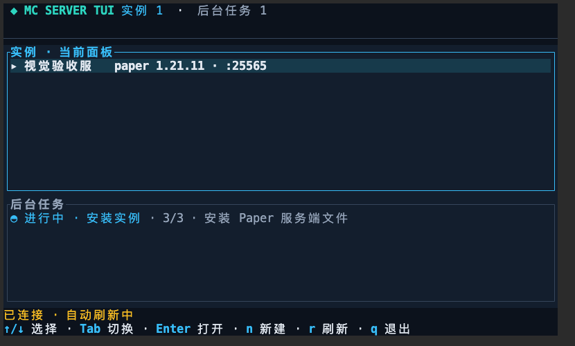

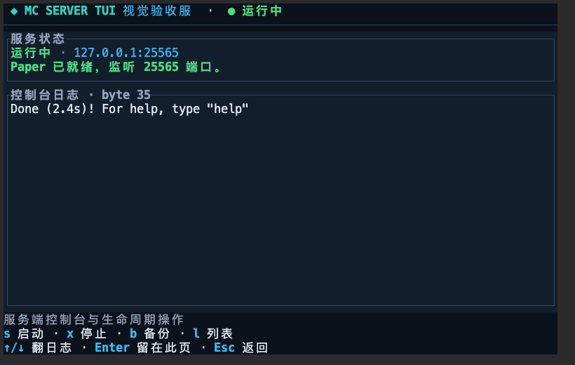


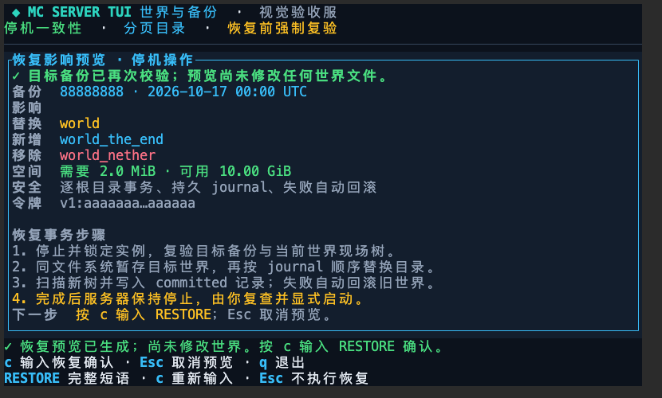

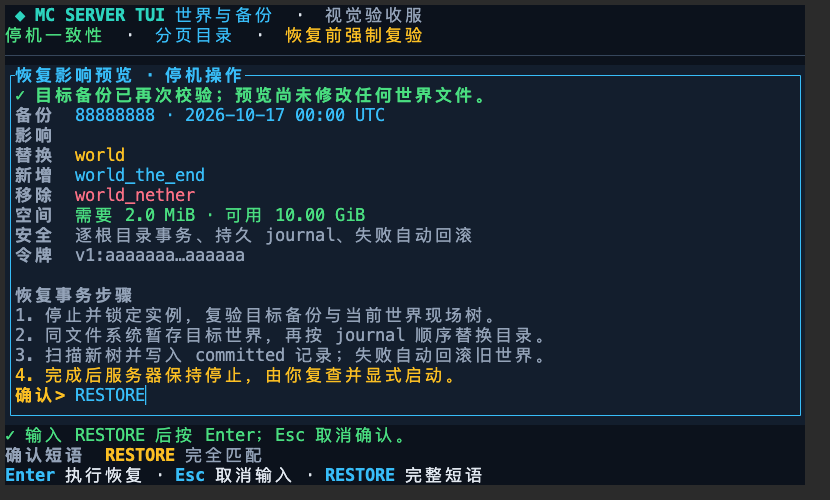

### 引导与整合包视觉验收（2026-10-18）

同一套 `ttyd` + Playwright 流程连接当时的协议 v8 假 daemon，在实测 80×24 终端中完成命令面板、向导三阶段、下载进度及整合包检查截图。截图只证明静态视觉层级；动画、输入、取消请求和 alternate-screen 恢复仍由 PTY/状态回归证明。

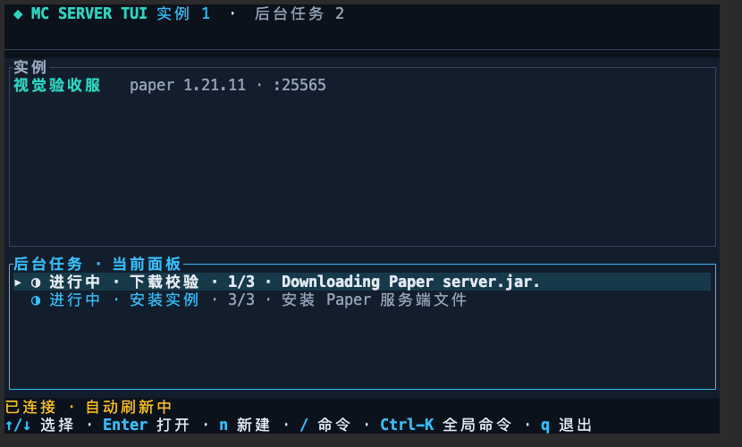

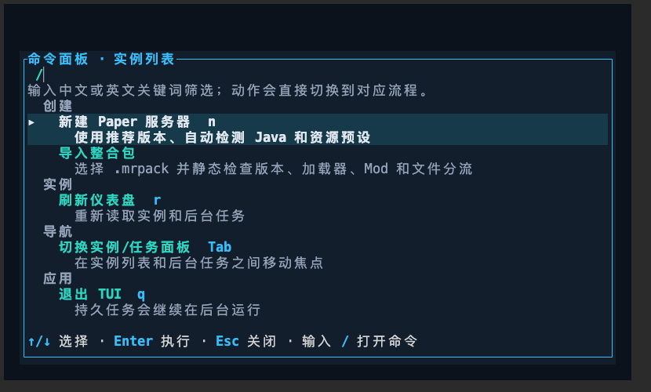

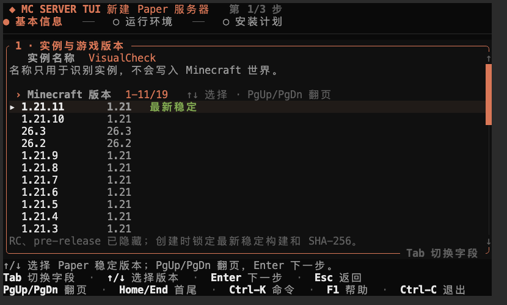

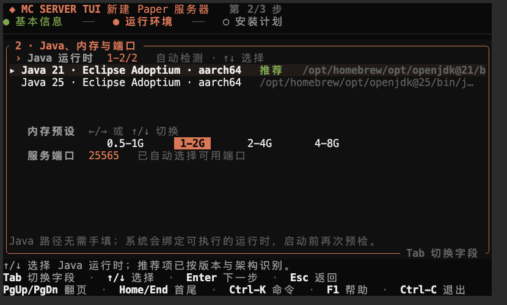
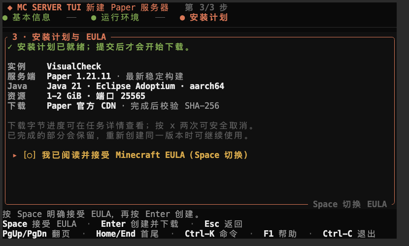


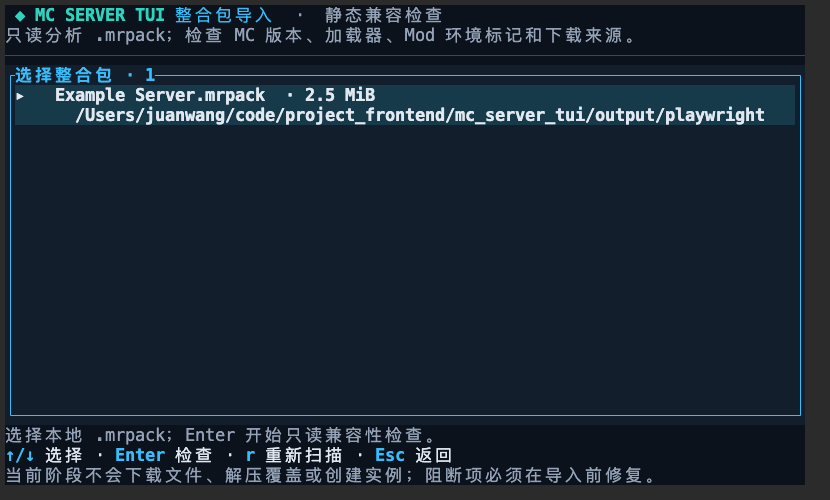

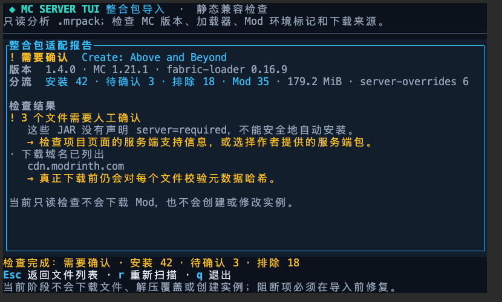

## 输入安全回归（2026-10-19）

当前输入契约已更新：不完整 slash 命令第一次按 Enter 只填入完整候选，第二次 Enter 才执行；完整 slash 命令可直接执行。`TerminalSession` 启用 bracketed paste 后，多行粘贴会折叠成一个待检查的单行输入，不会因换行自动提交。旧截图和 2026-10-18 的会话记录保留当时“Enter 执行高亮补全”的历史行为，不代表当前契约。

相关回归：`app::tests::shell_enter_completes_a_partial_command_before_dispatching_it`、多行粘贴状态测试、`runtime::input::tests::command_palette_keeps_j_and_k_for_search_and_uses_arrows_for_navigation`、`wizard_view::tests::name_cursor_uses_terminal_columns_for_wide_characters`，以及四个 fake-daemon PTY 脚本 `tui_pty_smoke.py`、`tui_task_detail_pty.py`、`tui_guided_create_pty.py`、`tui_instance_detail_pty.py`。PTY 不模拟各宿主终端自身对普通剪贴板粘贴的处理；I-03/I-05 的真实终端验收仍需覆盖目标用户使用的终端。
