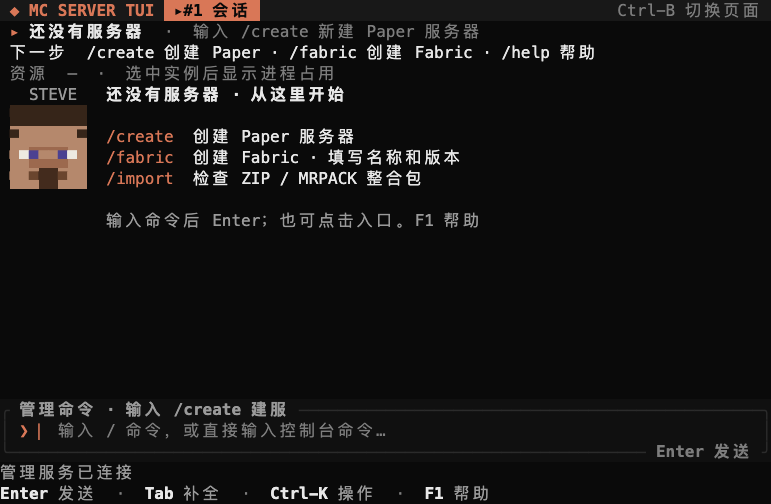
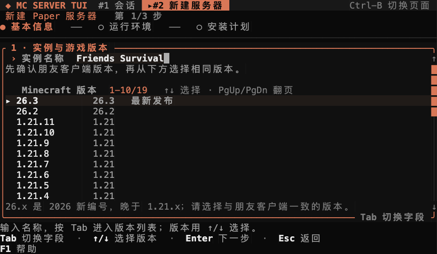
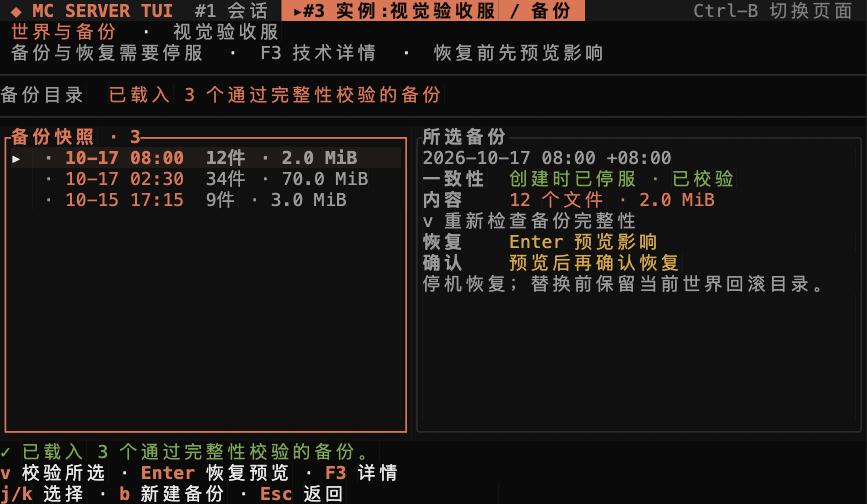
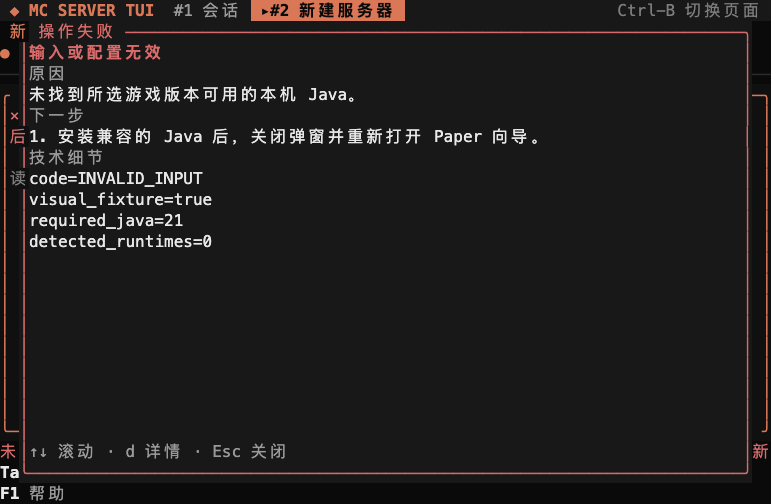

# mc-server-tui 使用手册

> 适用于 `v0.2.2`（未签名 alpha pre-release）。
> 本文描述当前已发布的 alpha，不承诺生产稳定性、数据恢复成功、对所有整合包的兼容，
> 也不承诺支持所有 Minecraft 版本。

## 1. 从这里开始

这份教程带你完成三个结果：创建一个受管实例、用客户端连接它、为世界保留一份可校验的备份。
首次使用按第 2–4 节操作；已有实例从第 5 节开始；遇到失败直接看第 13 节。
每个操作都标明应该看到的结果。完整命令可以在应用内输入 `/help` 查看。

### 托管世界前

`mc-server-tui` 是独立的终端 Minecraft Java 服务端管理工具，与 Mojang、
Microsoft、PaperMC、Modrinth、Fabric、Forge 均无隶属关系。Minecraft 及相关商标
归各自权利人所有。

你需要自行负责：

- 阅读并接受 Minecraft EULA；
- 只使用你有权使用的服务端软件、插件、模组、整合包、世界和玩家数据；
- 在应用之外保留独立备份；
- 防火墙、端口转发、公网暴露、密码、权限和主机安全；
- 在依赖某个插件、模组、整合包或更新之前，验证它能正常工作。

当前 alpha 没有代码签名或 macOS 公证。发布文件提供 SHA-256 完整性校验，但这不等于
可信签名。服务端软件和第三方扩展会以你的用户权限执行。请使用专用账户，不要安装
来源不明的文件。软件按仓库的 MIT OR Apache-2.0 许可证提供，不保证持续可用或数据可恢复。

## 2. 支持范围

| 平台 | `v0.2.2` 发布目标 |
| --- | --- |
| macOS 13+ Apple Silicon | `aarch64-apple-darwin` |
| Linux x86_64 | `x86_64-unknown-linux-gnu` |
| Linux arm64 | `aarch64-unknown-linux-gnu` |
| Intel macOS | 当前版本不提供 |

**准备好再继续：** 先安装匹配游戏版本的 Java；应用对 1.21.x 推荐 Java 21，对 26.x 推荐 Java 25+。Paper 向导只发现本机运行时，不自动安装 Java。

TUI 依赖 Unix socket 和 Unix 进程语义，本版本不支持 Windows。建议使用至少 80×24
的终端；40×12 可用，但会减少装饰和辅助信息。

Java 必须与 Minecraft/服务端版本匹配。向导会发现本机 Java 并给出推荐，但服务端版本、
插件/模组和玩家客户端兼容性仍由你确认。

## 3. 安装

### 使用 release 安装器

`v0.2.2` 是 pre-release，请使用带 tag 的地址：

```sh
TAG=v0.2.2
curl -fsSL "https://github.com/JUANWANG-BUAA/mc-server-tui/releases/download/$TAG/install.sh" | sh
mc setup
mc
```

`mc setup` 会写入当前用户配置、检查 Java、安装可用的 launchd/systemd 用户服务、
启动 daemon，并提示通过 `mc` 打开 TUI。只写配置、不安装后台服务：

```sh
mc setup --no-service
mc daemon run   # 终端 1
mc tui          # 终端 2
```

**应该看到：** `mc setup` 完成配置与服务初始化；运行 `mc` 后，空会话显示
Paper、Fabric、整合包三个入口，底部显示管理服务已连接。输入命令或点击入口即可开始。
输入中的内容会替换欢迎页，操作结果不会被欢迎内容遮住。

**如果没有成功：** 找不到 `mc` 时，执行 `export PATH="$HOME/.local/bin:$PATH"`；
管理服务未连接时，执行 `mc service status --json` 与 `mc service start`。
需要查看将要写入的位置时，先运行 `mc setup --dry-run`。



### 从源码构建

仓库固定 Rust 1.89.0：

```sh
git clone https://github.com/JUANWANG-BUAA/mc-server-tui.git
cd mc-server-tui
cargo build --workspace
./target/debug/mc setup --dry-run
./target/debug/mc setup
./target/debug/mc
```

检查版本、协议和本机环境：

```sh
mc version --json
mc status --json
mc doctor --json
```

## 4. 创建第一个服务器

欢迎页中的 Paper 入口会打开向导。也可以在 `mc` 会话输入以下命令并按 Enter：

```text
/create
```

Paper 引导流程包括：

1. 实例名称与 Minecraft 版本；
2. Java、内存范围和服务端端口；
3. 服务端产物、下载来源、内存、端口与 EULA 的最终检查。



运行设置默认展示摘要，并保留实例名与游戏版本。Enter 接受当前设置，F3 或 Tab
展开 Java、内存与端口。

新版年号版本如 `26.3`、`26.2` 会排在旧式 `1.21.x` 前面。请选择玩家客户端实际使用的
精确版本。EULA 必须由你明确确认，默认不会勾选。

提交后使用：

```text
/tasks
/task <序号>
```

查看下载字节、来源、速度、阶段和取消状态。

### 确认实例并首次连接

**应该看到：** 创建任务完成，`/instances` 中出现新实例。先选择它，再启动：

```text
/instances
/use <序号或名称>
/start
/connect
```

等待 Minecraft 状态显示就绪，再用相同游戏版本的 Java 客户端连接。
同机通常为 `localhost:25565`，以 `/connect` 显示的端口为准；异机还要检查网络与防火墙。
底部“管理服务已连接”不等于 Minecraft 已就绪。

**如果没有成功：** `/tasks` 和 `/task <序号>` 查看建服失败原因，
`/open` 或 `/logs` 查看启动日志。关闭错误弹窗后可以回到原来的页面修正设置。

### 创建 Fabric

点击 Fabric 入口只会填入 `/fabric ` 草稿，不会自动提交。
补充名称、精确游戏版本，并在阅读且同意 Minecraft EULA 后加入确认参数：

```text
/fabric MyFabricServer 1.21.11 --accept-eula
```

该路径会解析稳定 Fabric loader、准备兼容 Java、检查端口，并创建受管实例。
参数不完整时只显示用法，不会创建服务器。

## 5. 会话 shell

默认界面是会话 shell。不带 `/` 的文本会发送给当前 Minecraft 控制台；斜杠命令用于
管理应用。

常用命令：

| 命令 | 用途 |
| --- | --- |
| `/help`、`F1` | 查看全部命令和快捷键 |
| `/instances`、`/use <序号或名称>` | 列出并选择实例 |
| `/open` | 打开当前实例详情 |
| `/start`、`/stop`、`/restart` | 启动、优雅停止、受控重启 |
| `/logs` | 在会话中查看控制台尾部 |
| `/console <命令>` | 向 Minecraft 控制台发送命令 |
| `/tasks`、`/task <n>`、`/cancel [n]` | 查看或取消持久任务 |
| `/backup`、`/backups` | 创建或管理停机世界备份 |
| `/config` | 编辑四个常用 `server.properties` 字段 |
| `/players [操作] [玩家]` | OP、白名单、封禁、解封、踢出、LuckPerms |
| `/rg [-i] [-e] <模式>` | 搜索当前和轮转日志 |
| `/connect`、`/monitor` | 查看联机地址和运行状态 |
| `/mods`、`/import`、`/export` | 扩展和整合包流程 |
| `/pages`、`/page <n>`、`/close [n]` | 工作区页面 |
| `/theme [主题]`、`F2` | 主题 |
| `/quit` | 退出 TUI；服务端和任务继续运行 |

快捷键：`Enter` 提交、`Tab` 补全、`←/→` 移动光标、`Home/End` 行首尾、
`↑/↓` 历史或选择、`Ctrl-K` 命令面板、`F2` 主题、`F1` 帮助。

顶部固定当前实例、下一步动作与资源，后台进度只显示一次；管理服务连接与游戏就绪
分别显示。控制台草稿标明目标并绑定开始输入时的实例。切换实例后，需切回原实例
或按 Esc 清空重写，才能发送。实例日志页 F3 展开诊断，Ctrl-K 也能找到相同入口。

## 6. 生命周期与就绪

- `/start` 幂等启动，并检查 Java、server.jar、端口和进程身份。
- `/stop` 发送 Minecraft 的优雅 `stop`，等待已验证进程退出；超时不会强杀 Java。
- `/restart` 只接受已验证的 starting/running 进程，先优雅停止，确认干净退出后再启动
  同一实例。停止不干净时不会自动创建替代进程。
- 就绪必须有服务端 `Done (` 标记；端口打开不等于服务器可加入。
- 关闭 TUI 或 daemon 不会杀死常驻 runner 或 Java 进程。

实例详情页 `/open` 提供生命周期、控制台、日志、进程身份、CPU/RSS 和告警。`R` 执行
受控重启，`c` 打开配置。

## 7. 常用服务端配置

```text
/config
```

当前编辑器支持 MOTD、人数上限、难度和视距。保存前会展示差异，保留未知键和注释；
文件被外部修改时会拒绝覆盖。运行中保存不会自动重启，需要 `/restart` 或 `R` 后生效。

原始编辑、完整属性目录和逐版本校验尚未实现。其余属性请在服务器停止时直接编辑
`server.properties`，并先保留自己的备份。

## 8. 备份与恢复

当前只支持停服备份。先运行 `/stop`，等待状态变为 `stopped`，再执行 `/backup`。
`/tasks` 中任务完成后，再进入 `/backups` 查看快照。

**应该看到：** 快照有明确时间、文件数和大小。校验成功后才能据此继续恢复；
列表中存在一条快照，不代表它已经通过本次校验。

1. 停止服务器并等待状态为 `stopped`；
2. 执行 `/backup`；
3. 打开 `/backups` 并选择已验证快照；
4. 按 `v` 复验，按 `Enter` 生成恢复计划；
5. 检查受影响世界、增加/替换/移除目录、staging 空间和安全步骤；
6. 按 `c`，输入精确的 `RESTORE` 确认并提交。

恢复使用事务和回滚证据，提交前不会报告成功。恢复完成后服务器保持停止，需要手动启动，
并用 Minecraft 客户端验证世界内容。当前没有在线备份或定时备份。



备份详情使用本地时间并标注 UTC 偏移；F3 查看技术证据。创建备份后按 `r` 刷新。
恢复会替换预览列出的世界，不会合并备份之后的进度。按 `c` 后输入完整 `RESTORE` 确认。

## 9. 玩家、日志与工作区

示例：

```text
/players list
/players op Steve
/players allow Alex
/players whitelist-on
/players kick Steve reason
```

按玩家名执行在线操作可能需要 Mojang 档案查询，受限网络下可能超时。TUI 会显示服务端
响应或超时错误，不会伪造成功。

`/rg` 搜索当前和上一份轮转日志，`/logs` 显示最近输出，`/monitor` 显示游戏状态和在线
人数。CPU/RSS 是本机观测，不等于 TPS/MSPT 或 JVM 堆指标。

工作区页面会保留日志过滤和阅读位置；关闭页面不会停止服务端。

## 10. Fabric、扩展与整合包

- `/mods search <名称>`、`/mods install <名称>` 安装受支持的 Modrinth Paper 插件
  或 Fabric 模组、必需目录依赖和已验证 JAR；实例必须停止。
- `/import` 预览 `.mrpack` 或服务端 ZIP；`/import <路径> --apply` 暂存并校验兼容的
  `mods`、`plugins`、`config`，拒绝冲突、越界路径、世界/身份数据、`server.jar` 和
  `server.properties`。
- `/export <路径.zip>` 生成带 SHA-256 清单的服务端扩展和配置包，不是客户端启动器包。

导入不会执行包内脚本，也不证明组合后的插件/模组一定能启动。导入后必须验证。
Forge/NeoForge 和 CurseForge 文件 ID 下载尚未实现。

## 11. CLI

CLI 与 TUI 使用同一套类型化 daemon API：

```sh
mc cli instance list
mc cli instance start <实例 ID>
mc cli instance stop <实例 ID> --timeout-seconds 20
mc cli instance restart <实例 ID> --timeout-seconds 20
mc cli backup create <实例 ID>
mc cli backup list <实例 ID>
mc cli task list
mc cli modpack inspect /path/server.mrpack
```

生命周期命令返回的是状态观察；服务器可能仍是 `starting`。请继续轮询详情，直到观察到
就绪标记，或在 TUI 中查看。

## 12. 服务、更新与数据

```sh
mc service install
mc service status --json
mc service restart
mc service uninstall
mc update status
mc update rollback --dry-run
```

用户服务监督 daemon；Java 由独立常驻 runner 持有。`mc service restart` 只重启 daemon，
不会杀死正在运行的服务器。卸载默认保留实例数据，只有明确要求清理时才可能删除。

`mc doctor` 会打印精确数据目录。世界位于
`<state>/instances/<uuid>/server/`。服务端运行时不要编辑 UUID 目录。配置、socket、
state 和 cache 路径可在 `config.toml` 或文档化环境变量中覆盖。

## 13. 排错

### 先读操作失败弹窗

创建、实例管理、控制台、备份、整合包检查和配置操作失败时，弹窗显示实际原因和恢复建议。
按 `d` 或 F3 展开错误代码与证据，↑/↓ 或滚轮滚动，Esc 或 Enter 关闭。
弹窗打开期间，普通按键、粘贴与点击不会触发背后的操作；关闭后原页面和草稿仍保留。
弹窗不会自动重试，也没有剪贴板复制功能。后台连接轮询失败仍显示在状态栏。

按建议修正后，手动重新提交。需要报告问题时，记录原因、错误代码和相关日志，先检查其中的路径与敏感信息。



### 检查服务与环境

先运行：

```sh
mc version --json
mc doctor --json
mc status --json
```

实例详情会从当前日志识别常见启动失败：

| 现象 | 首先检查 |
| --- | --- |
| `UnsupportedClassVersionError` | 选择与服务端/MC 版本兼容的 Java |
| 端口绑定失败 | 停止占用进程或更换端口 |
| EULA 警告 | 阅读并明确接受 Minecraft EULA |
| `OutOfMemoryError` | 在主机容量内提高实例最大内存 |
| JAR 缺失或损坏 | 重新安装锁定的服务端构建 |

未知错误请使用 `/open` 和 `/rg` 查看当前及轮转日志。不要强杀身份未知的 PID；
监督器不会向无法核验的进程发送信号。

daemon 不可用时：

```sh
mc service status --json
mc service start
mc doctor --json
```

## 14. 网络暴露

`/connect` 会列出本机、局域网和可能的外网地址，但不能证明远端朋友一定可连接。
端口转发、NAT、防火墙、运营商限制和 DNS 不在应用控制范围内。

不要把管理主机直接暴露到公网。请使用专用用户、限制文件权限、保持 daemon socket 私有、
配置防火墙，并审查插件/模组权限。Minecraft 服务端和第三方代码可能存在漏洞。

## 15. 证据与当前限制

[v0.2.2 验收记录](https://github.com/JUANWANG-BUAA/mc-server-tui/blob/v0.2.2/docs/acceptance/0.2.2.md)记录本轮 Rust、五套 PTY、协议窗口与双语网页验证。
此前的 [v0.2.1 真实 Paper 演练](https://github.com/JUANWANG-BUAA/mc-server-tui/blob/v0.2.1/docs/acceptance/0.2.1.md)完成控制台、停服、备份、标记文件恢复与恢复后就绪；本轮没有将它记为新的游戏进程验收。
这些检查不证明所有世界、插件、网络或客户端场景都可用。真实客户端进入恢复后的世界核验仍待完成。

任务历史会持久保存，但 daemon 重启会将排队和执行中的任务标记为 `interrupted`，不会自动重放。
下载文件的续传能力不等于整个任务自动恢复。

当前缺口包括 Vanilla、接管现有目录、完整 `server.properties`、在线/定时备份、
Forge/NeoForge、CurseForge 文件 ID 下载、签名/公证、签名自动更新器、状态迁移、
更新前任务排空和真实 Linux 服务验证。

## 16. 许可证与免责声明

项目采用 MIT OR Apache-2.0 许可证。许可证治理软件本身，不提供本手册之外的保证或支持
承诺。你需要对备份、访问控制、托管内容、第三方许可证、Minecraft EULA 和适用法律负责。

如果世界很重要，请保留独立备份，并在更换服务端软件、插件、模组或配置前验证恢复流程。
